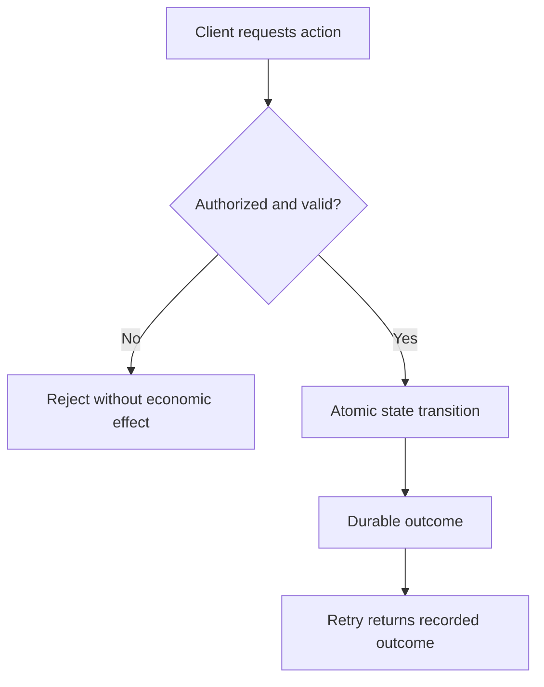

# Visual Explanations: Editorial Standard

Status: draft policy, subject to accessibility and technical review.

Visuals must teach, not decorate. Prefer diagrams when they clarify sequence, state, trust boundaries, data provenance, component responsibilities or failure/recovery.

## Requirements

1. Every diagram must have a descriptive title, short caption and adjacent textual explanation that conveys the same essential meaning. AI readers and screen-reader users must not depend on interpreting pixels.
2. Use Mermaid for diagrams supported by the current Docusaurus build, but validate rendered dimensions, mobile overflow, light/dark contrast, reduced-motion behavior and keyboard accessibility. Mermaid source is not itself an accessibility substitute.
3. Never imply a hypothetical design is implemented. Mark each diagram **Conceptual**, **Design under validation**, **Implemented**, or **Verified**, with specific evidence for the last two.
4. Prefer simple left-to-right or top-to-bottom flows with a small number of nodes. Break complex processes into multiple diagrams.
5. Preserve the same logical diagram across EN, PT-BR and ES. Translate visible labels naturally while retaining exact identifiers.
6. Do not use charts with invented metrics, fabricated timelines or unsupported percentages. Quantitative charts require named datasets, measurement windows and citations.
7. When a diagram mentions an external provider, bank or blockchain, distinguish observed signals from protocol authority and do not imply external settlement guarantees.
8. Before publishing, verify source references, figure captions, responsive rendering and text equivalents.

## Suggested visual plan

- 03 Architecture: conceptual layered relationship between Protocol, Core, Node, SDK and applications.
- 06 Idempotency: retry -> existing durable result vs new authorized operation.
- 07 Concurrency: two contenders -> one authoritative commit.
- 08 Crash recovery: before/after transaction boundary, restart and replay.
- 09 Identity: authentication vs authorization decision.
- 10 Evidence: authenticated uploader -> bounded reference -> proof ledger.
- 11 Reputation: provenance and context when sharing reputation signals.
- 12 Settlement: external observation vs authorized state transition.
- 13 Adversarial nodes: trust boundaries and rejection paths.

## Example conceptual Mermaid

This example is illustrative, not proof of implementation. Validate actual transaction boundaries per adapter and operation.
