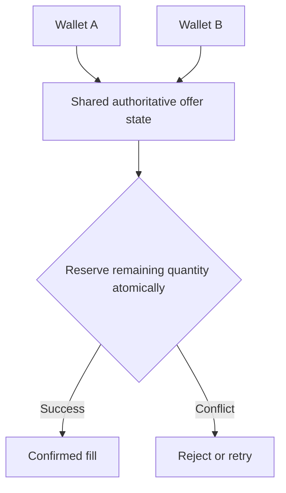

## The shift

A wallet, a web terminal and a third-party application should not each have to manufacture their own isolated market. The ambition of Sails Market is to demonstrate a reference interface to shared economic coordination, not to pretend that Sails already owns a universal order book or supplies proprietary liquidity. Private rooms can govern visibility and participation without changing who controls funds or authorizes settlement.

<!-- truncate -->

## The design response

Imagine two interfaces showing the final available unit of an offer. If both users accept at the same moment, neither interface can safely decide the winner using a cached screen. Coordination requires a shared authority for the offer state, concurrency controls and clear recovery behavior when a participant disconnects. Different interfaces can compete on experience only if they agree on the underlying economic facts.

## One offer, two screens, one remaining fill

Imagine an offer visible in Sails Market and in a third-party wallet. Both clients display the last available amount. One participant accepts it, but the other screen has not refreshed. Shared discovery cannot be confused with reserved liquidity. Acceptance must be checked against authoritative current state, permissions, payment method and quote validity. A private room can change who is eligible to see or act on an offer without creating a separate economic truth. This is the design objective, not a claim that cross-application concurrency has already passed production tests. The required proof is a race test in which exactly one valid acceptance succeeds and the losing client receives a recoverable outcome.

## Interoperability needs a shared source of truth

If one interface shows a trade as completed and another shows it as open, a shared marketplace has failed at its most basic promise. Offers need stable identifiers, explicit expiration, consistent economic terms and state transitions that survive retries. Private rooms can restrict who sees an offer, but cannot be allowed to silently change the settlement obligations attached to it.

A wallet should be able to leave one interface and continue through another without losing the evidence needed to understand its trade. That is an architectural target for Sails, not a claim of verified production portability today.

## Competition belongs in the experience, not ownership of an order

Many digital financial products keep offers, users, history and liquidity inside the same closed system. That can simplify centralized decisions, but it makes entry harder for specialized interfaces. A merchant-focused wallet and a consumer app could serve different audiences without rebuilding an entire trading infrastructure.

Interoperability requires discipline. It does not mean every interface can change the same trade. An order needs identity, versioning, validity rules and well-defined authority. One app may display an opportunity and another may request acceptance, but economic confirmation must follow an inspectable source of truth.

## What happens when a client disappears?

Consider a merchant accepting an offer through Sails Market while a mobile wallet watches the same market. The merchant submits a request, the network times out, and the interface cannot tell whether the request committed. A retry must carry the same operation identity; otherwise a second screen could accidentally create a second obligation. The server must return a durable result or an explicit unresolved state that can be reconciled. A spinner or local success message is not evidence of settlement.

A reference implementation should make these distinctions visible: an *offer* is an invitation under defined terms; an *acceptance* is a request to commit; a *reservation* is a time-bound claim on availability; and *settlement* is a separate economic event. An interface may show all four, but it must not collapse them into one optimistic status. For a private room, membership rules must be checked at the authoritative transition, not merely when rendering the page.

## What would make the promise testable?

Before describing a market as shared in production, the team should publish a reproducible matrix: two clients racing for one fill; an acceptance retried after a timeout; a client reconnecting after server restart; room access revoked between discovery and acceptance; and two clients reading the same durable outcome. The expected result is one economic decision, consistent identifiers and a traceable explanation for every rejected or unresolved request. These are acceptance criteria, not assertions that the Sails deployment has already met them.

## Evidence boundary

Shared economic state is the design goal, not a verified claim of cross-application production interoperability.

## Shared offer state, multiple interfaces

The same offer cannot be independently filled twice merely because two applications display it.

