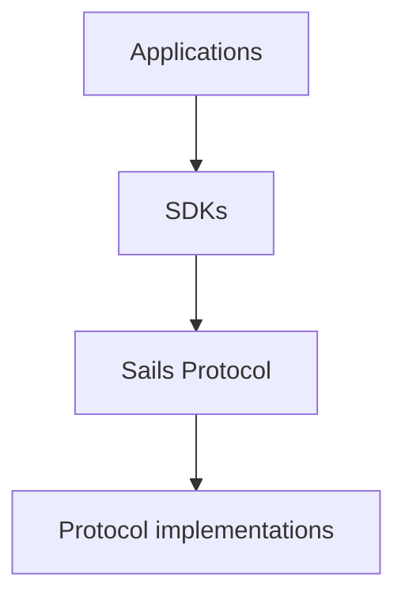

Sails Protocol is a project focused on **peer-to-peer economic coordination**. This article introduces its terminology, not a production-readiness claim.

<!-- truncate -->

## The ecosystem

This conceptual diagram is not a runtime or settlement flow.

## Terminology

- **Sails Protocol:** the coordination protocol.
- **Sails Core:** pure semantic core.
- **Sails Node:** an implementation or node.
- **Sails P2P Trading SDK:** first SDK in a planned family.
- **Sails Market:** independent reference web application.
- **Satsails Wallet:** a wallet application, distinct from the protocol.

## Technical source of truth

Consult the [Sails Protocol repository](https://github.com/sails-protocol/Sails-Protocol) for current implementation, evidence and technical decisions. An editorial article does not prove deployment, security properties or settlement guarantees.
