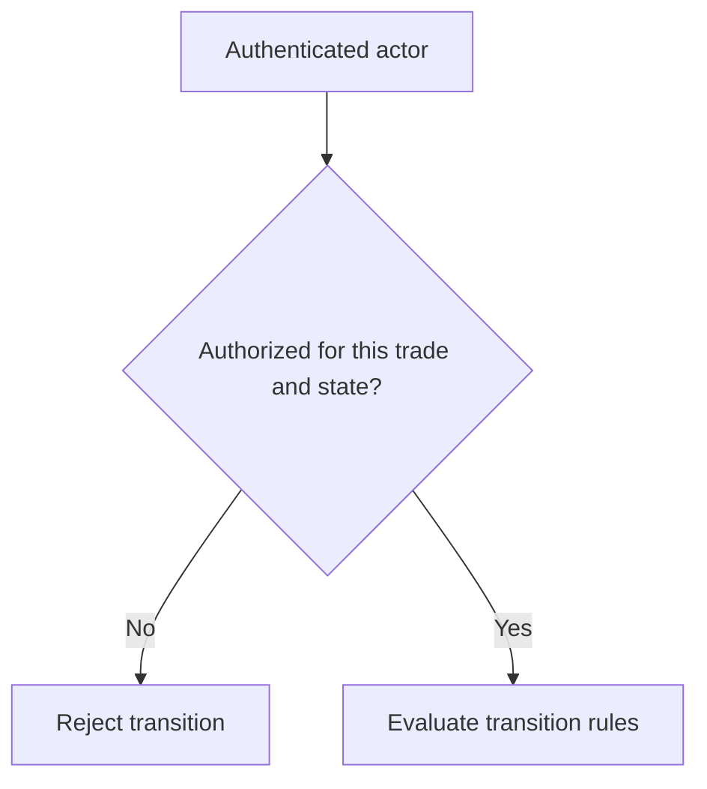

# Identity and Authorization Are Different Questions

*Editorial draft. Not approved for publication.*

## The question

A signed message can show control of a key. It cannot, by itself, prove that the key holder may release a particular trade. That second question depends on the trade, the role, the current state and the operation being requested.

## The hidden tradeoff

In P2P systems, it is tempting to treat a verified identity as a universal permission. But participants have different responsibilities. A buyer may submit payment evidence, a seller may confirm receipt and an authorized reviewer may assess a dispute. These are distinct authorities, even when everyone has authenticated successfully.

## Our direction

We are exploring portable identifiers and challenge-response mechanisms alongside explicit authorization at each state transition. Portability does not mean every application must trust every claim. Each integration still needs to decide which credentials and permissions it accepts.

## What we need to verify

The useful test is not merely whether a signature verifies. It is whether an authenticated actor can perform exactly the actions allowed by the current economic state, and no others. This article describes the security model we are working toward; concrete coverage must be linked to implementation evidence before publication.

## Conceptual diagram

This diagram illustrates a design principle, not verified runtime behavior.

## Verified distinction: proof of key control is not permission

The authentication middleware documents a challenge-response flow, signed request authentication and separate domain prefixes for registration and authentication challenges. That establishes a specific key-control proof boundary; it does not grant the signer authority over every trade. The trade service separately checks whether the authenticated participant is the buyer or seller before party-scoped actions. RFC-001 also states that an agent acts by delegation from a Participant; an agent or wallet is not an independent peer Participant implementation merely by having keys.

**Failure scenario:** a correctly signed request attempts to change another participant's trade. Valid cryptography cannot substitute for the trade membership check. Delegation limits and revocation need separate evidence.

### Primary source / maturity

- https://github.com/sails-protocol/Sails-Protocol/blob/be6d3bc2ddfc384cfafa4276e01b8aacc096d421/src/common/middleware/auth.ts
- https://github.com/sails-protocol/Sails-Protocol/blob/be6d3bc2ddfc384cfafa4276e01b8aacc096d421/src/modules/open-p2p/trade.service.ts
- https://github.com/sails-protocol/Sails-Protocol/blob/be6d3bc2ddfc384cfafa4276e01b8aacc096d421/docs/rfcs/RFC-001-participant-model.md

*Source inspection only; no new live test, CTO approval or publication authorization.*
