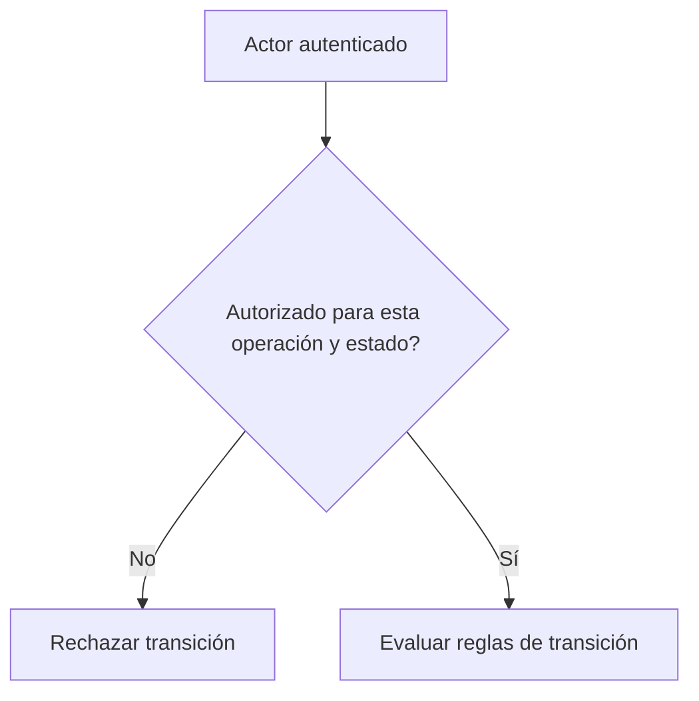

# Identidad y autorización son preguntas diferentes

*Borrador editorial. Publicación no aprobada.*

## La pregunta

Un mensaje firmado puede demostrar el control de una clave. Por sí solo no prueba que esa persona pueda liberar una operación concreta. Esa segunda pregunta depende de la operación, el rol, el estado actual y la acción solicitada.

## El dilema detrás

En sistemas P2P es tentador tratar una identidad verificada como un permiso universal. Pero los participantes tienen responsabilidades distintas. El comprador puede presentar una evidencia de pago, el vendedor puede confirmar la recepción y un revisor autorizado puede evaluar una disputa. Son autoridades diferentes, aunque todos se hayan autenticado correctamente.

## Nuestra dirección

Estamos explorando identificadores portátiles y mecanismos de desafío y respuesta, junto con autorización explícita en cada transición de estado. Portabilidad no significa que todas las aplicaciones deban confiar en cualquier afirmación. Cada integración debe decidir qué credenciales y permisos acepta.

## Qué necesitamos verificar

La prueba útil no consiste solo en verificar una firma. Consiste en demostrar que un actor autenticado puede ejecutar exactamente las acciones permitidas por el estado económico actual, y ninguna otra. Este artículo describe el modelo de seguridad en desarrollo; la cobertura concreta necesitará evidencias de implementación antes de publicarse.

## La decisión en el límite de confianza

Autenticar demuestra control de una credencial. Autorizar exige además comprobar que el participante pertenece a la operación y puede ejecutar esa acción. Validar la transición económica requiere verificar el estado actual. Son tres preguntas distintas. El código inspeccionado separa la verificación de desafíos firmados en `requireAuth` de la comprobación de comprador o vendedor en `TradeService.assertParticipant()`.

## Fallo: firma válida, operación ajena

Una solicitud puede estar firmada correctamente y aun así intentar modificar una operación de otra persona. La firma no reemplaza la autorización. RFC-001 también distingue a un agente delegado de un Participant independiente; el alcance y la revocación de esa delegación necesitan evidencia propia. Estos hechos inspeccionados no prueban cobertura universal de todas las rutas.

## Diagrama conceptual

Este diagrama ilustra un principio de diseño, no un comportamiento de ejecución verificado.

## Distinción comprobada: demostrar control de clave no concede permisos

El middleware de autenticación documenta challenge-response, autenticación de solicitudes firmadas y prefijos de dominio separados para desafíos de registro y autenticación. Esto demuestra control de la clave en un contexto específico, pero no concede autoridad sobre todas las operaciones. El servicio verifica por separado si el participante autenticado es comprador o vendedor para acciones reservadas a las partes. RFC-001 establece además que los agentes actúan por delegación de un Participant; tener claves no convierte automáticamente a una cartera o agente en Participant independiente.

**Escenario adversarial:** una solicitud correctamente firmada intenta cambiar la operación de otra persona. La criptografía válida no sustituye la comprobación de participación. Los límites y la revocación de delegación requieren pruebas propias.

### Primary source / maturity

- [auth.ts](https://github.com/sails-protocol/Sails-Protocol/blob/be6d3bc2ddfc384cfafa4276e01b8aacc096d421/src/common/middleware/auth.ts)
- [trade.service.ts](https://github.com/sails-protocol/Sails-Protocol/blob/be6d3bc2ddfc384cfafa4276e01b8aacc096d421/src/modules/open-p2p/trade.service.ts)
- [RFC-001-participant-model.md](https://github.com/sails-protocol/Sails-Protocol/blob/be6d3bc2ddfc384cfafa4276e01b8aacc096d421/docs/rfcs/RFC-001-participant-model.md)

*Source inspection only; no new live test, CTO approval or publication authorization.*
