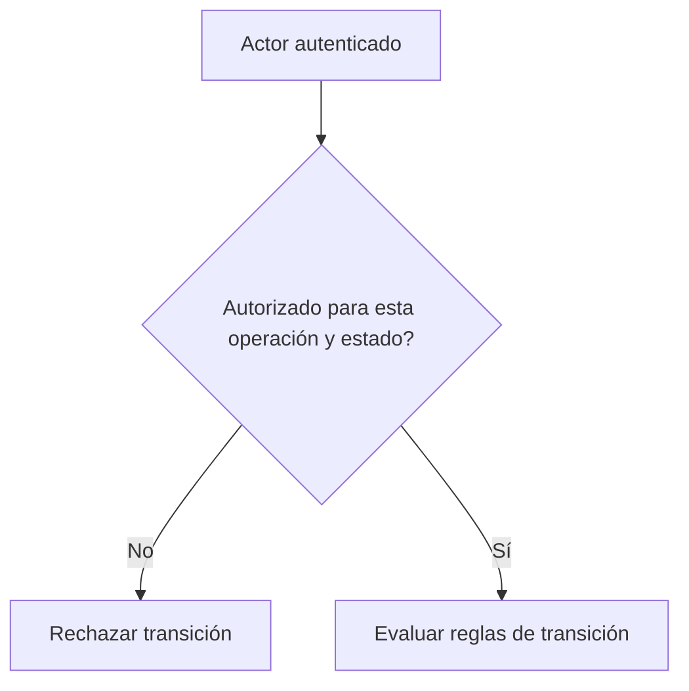

# Identidad y autorización son preguntas diferentes

*Borrador editorial. Publicación no aprobada.*

## La pregunta

Un mensaje firmado puede demostrar el control de una clave. Por sí solo no prueba que esa persona pueda liberar una operación concreta. Esa segunda pregunta depende de la operación, el rol, el estado actual y la acción solicitada.

## El dilema detrás

En sistemas P2P es tentador tratar una identidad verificada como un permiso universal. Pero los participantes tienen responsabilidades distintas. El comprador puede presentar una evidencia de pago, el vendedor puede confirmar la recepción y un revisor autorizado puede evaluar una disputa. Son autoridades diferentes, aunque todos se hayan autenticado correctamente.

## Nuestra dirección

Estamos explorando identificadores portátiles y mecanismos de desafío y respuesta, junto con autorización explícita en cada transición de estado. Portabilidad no significa que todas las aplicaciones deban confiar en cualquier afirmación. Cada integración debe decidir qué credenciales y permisos acepta.

## Qué necesitamos verificar

La prueba útil no consiste solo en verificar una firma. Consiste en demostrar que un actor autenticado puede ejecutar exactamente las acciones permitidas por el estado económico actual, y ninguna otra. Este artículo describe el modelo de seguridad en desarrollo; la cobertura concreta necesitará evidencias de implementación antes de publicarse.

## Diagrama conceptual

Este diagrama ilustra un principio de diseño, no un comportamiento de ejecución verificado.

*Referencias técnicas y aprobación pendientes.*
