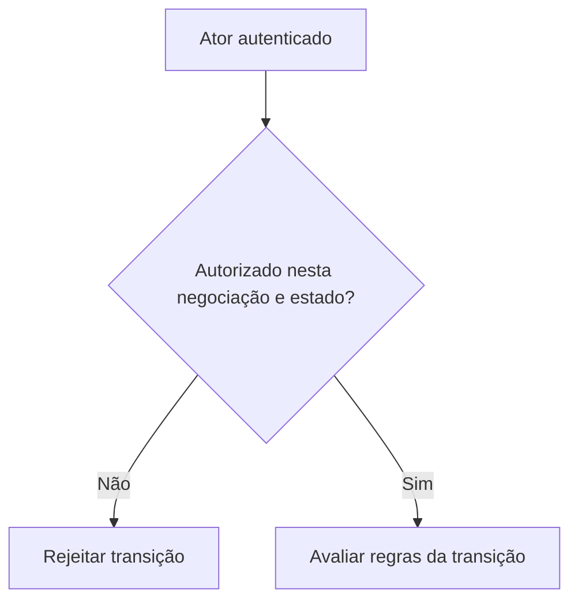

# Identidade e autorização são perguntas diferentes

*Rascunho editorial. Publicação não aprovada.*

## A pergunta

Uma mensagem assinada pode demonstrar controle sobre uma chave. Sozinha, não prova que essa pessoa pode liberar uma negociação específica. Essa segunda pergunta depende da negociação, do papel do participante, do estado atual e da operação solicitada.

## O dilema por trás

Em sistemas P2P, é tentador tratar uma identidade verificada como uma permissão universal. Mas os participantes têm responsabilidades diferentes. O comprador pode apresentar evidência de pagamento, o vendedor pode confirmar recebimento e um revisor autorizado pode avaliar uma disputa. São autoridades distintas, mesmo quando todos se autenticaram corretamente.

## Nossa direção

Estamos explorando identificadores portáveis e mecanismos de desafio e resposta, junto de autorização explícita em cada transição de estado. Portabilidade não significa que toda aplicação deva confiar em qualquer afirmação. Cada integração ainda precisa decidir quais credenciais e permissões aceita.

## O que precisamos verificar

O teste útil não é apenas verificar uma assinatura. É comprovar que um ator autenticado consegue executar exatamente as ações permitidas pelo estado econômico atual, e nenhuma outra. Este artigo descreve o modelo de segurança que estamos construindo; a cobertura concreta precisará de evidências de implementação antes da publicação.

## Diagrama conceitual

Este diagrama ilustra um princípio de projeto, não um comportamento de execução verificado.

*Referências técnicas e aprovação pendentes.*
