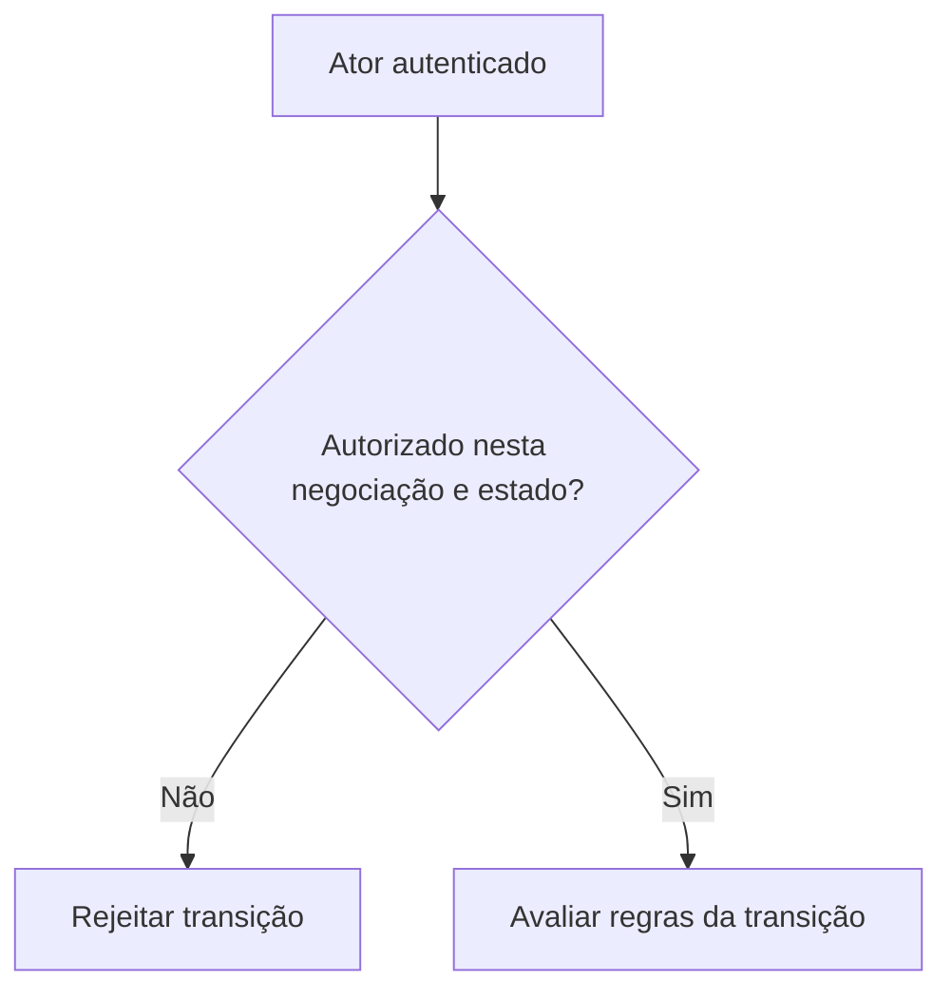

# Identidade e autorização são perguntas diferentes

*Rascunho editorial. Publicação não aprovada.*

## A pergunta

Uma mensagem assinada pode demonstrar controle sobre uma chave. Sozinha, não prova que essa pessoa pode liberar uma negociação específica. Essa segunda pergunta depende da negociação, do papel do participante, do estado atual e da operação solicitada.

## O dilema por trás

Em sistemas P2P, é tentador tratar uma identidade verificada como uma permissão universal. Mas os participantes têm responsabilidades diferentes. O comprador pode apresentar evidência de pagamento, o vendedor pode confirmar recebimento e um revisor autorizado pode avaliar uma disputa. São autoridades distintas, mesmo quando todos se autenticaram corretamente.

## Nossa direção

Estamos explorando identificadores portáveis e mecanismos de desafio e resposta, junto de autorização explícita em cada transição de estado. Portabilidade não significa que toda aplicação deva confiar em qualquer afirmação. Cada integração ainda precisa decidir quais credenciais e permissões aceita.

## O que precisamos verificar

O teste útil não é apenas verificar uma assinatura. É comprovar que um ator autenticado consegue executar exatamente as ações permitidas pelo estado econômico atual, e nenhuma outra. Este artigo descreve o modelo de segurança que estamos construindo; a cobertura concreta precisará de evidências de implementação antes da publicação.

## A decisão na fronteira de confiança

Três verificações precisam permanecer separadas. **Autenticação** pergunta se o solicitante controla a credencial apresentada. **Autorização da negociação** pergunta se aquele participante faz parte da negociação e pode executar a ação. **Validade da transição econômica** pergunta se o estado atual permite o efeito solicitado. Passar na primeira não autoriza ignorar as outras duas.

O código examinado demonstra parte dessa separação: `requireAuth` verifica desafios assinados e distingue os domínios de registro e autenticação; `TradeService.assertParticipant()` verifica se o participante é comprador ou vendedor. Isso é mais específico do que afirmar que todas as rotas e ações delegadas foram auditadas integralmente.

## Falha: assinatura válida na negociação errada

Um atacante pode assinar corretamente com a própria chave e apontar a requisição para a negociação de outra pessoa. A assinatura é autêntica; a operação continua proibida. Rejeitá-la antes de alterar o estado protege a fronteira econômica. Para agentes há outra camada: a RFC-001 define atuação **por delegação** de um Participant, não como Participant independente por padrão. Escopo e revogação dessa delegação ainda exigem evidência própria.

## Diagrama conceitual

Este diagrama ilustra um princípio de projeto, não um comportamento de execução verificado.

## Distinção comprovada: provar a chave não concede autorização

O middleware de autenticação documenta challenge-response, autenticação de requisições assinadas e prefixos de domínio distintos para desafios de registro e autenticação. Isso demonstra controle da chave em um contexto específico, mas não concede poder sobre todas as negociações. O serviço de negociação verifica separadamente se o participante autenticado é comprador ou vendedor nas ações restritas às partes. A RFC-001 também estabelece que agentes atuam por delegação de um Participant; carteira ou agente não vira automaticamente um Participant independente por possuir chaves.

**Cenário adversarial:** uma requisição com assinatura válida tenta alterar a negociação de outra pessoa. A criptografia correta não substitui a checagem de participação. Limites e revogação de delegação exigem evidências próprias.

### Primary source / maturity

- [auth.ts](https://github.com/sails-protocol/Sails-Protocol/blob/be6d3bc2ddfc384cfafa4276e01b8aacc096d421/src/common/middleware/auth.ts)
- [trade.service.ts](https://github.com/sails-protocol/Sails-Protocol/blob/be6d3bc2ddfc384cfafa4276e01b8aacc096d421/src/modules/open-p2p/trade.service.ts)
- [RFC-001-participant-model.md](https://github.com/sails-protocol/Sails-Protocol/blob/be6d3bc2ddfc384cfafa4276e01b8aacc096d421/docs/rfcs/RFC-001-participant-model.md)

*Source inspection only; no new live test, CTO approval or publication authorization.*
