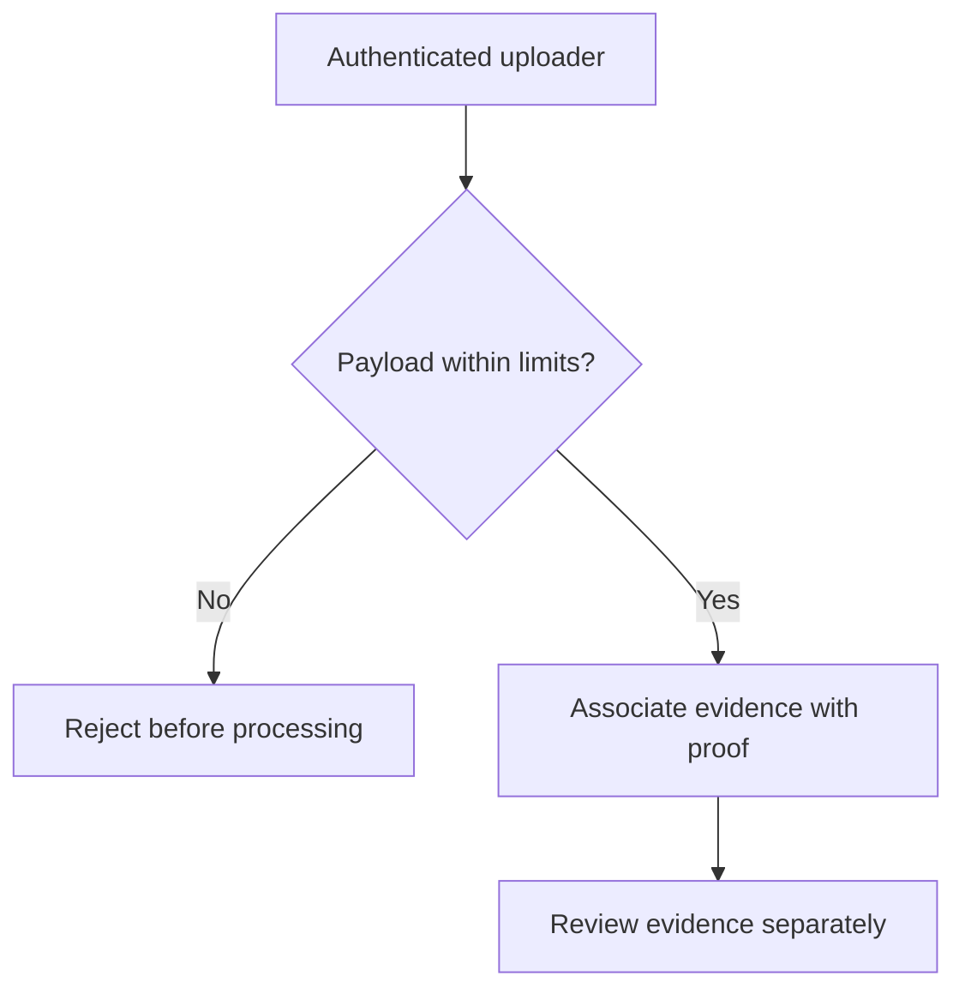

# Evidence, Provenance and Resource Limits

*Editorial draft. Not approved for publication.*

## The question

A screenshot may help explain a dispute, but a system must first answer more basic questions: who uploaded it, which proof it belongs to, how large it is and whether it is allowed to enter the workflow.

## The hidden tradeoff

Without limits, evidence becomes an attack surface. An attacker can submit oversized payloads, too many references or deeply nested data to consume resources before any human has a chance to review a claim. Boundaries need to be enforced before expensive processing, not merely documented in an API description.

## Our direction

In our OpenProof work, we have defined policies for inline evidence and provider-backed references, including authenticated provenance and cumulative quotas. A policy decision is not the same as complete enforcement across all routes and providers. We will publish precise values only with their version, scope and verified implementation status.

## What we need to verify

Evidence is also not truth by decree. A valid upload proves that a permitted actor submitted data under certain constraints. Whether that data establishes a payment, an agreement or misconduct remains a separate question for the relevant verification and dispute process.

## Conceptual diagram

This diagram illustrates a design principle, not verified runtime behavior.

*Technical references and approval pending.*
