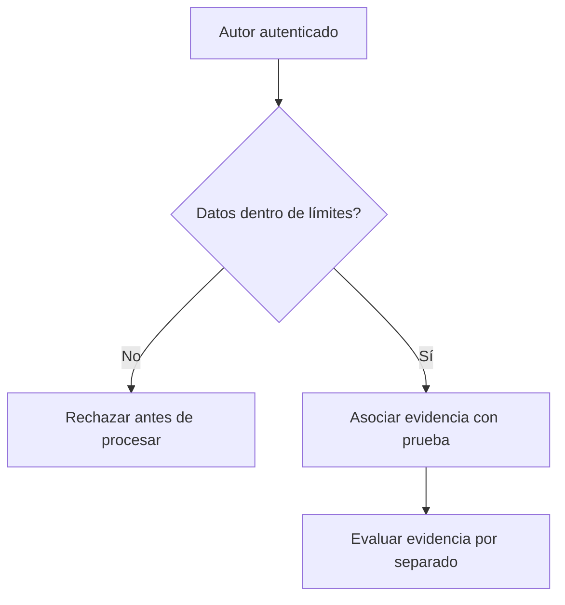

# Evidencias, procedencia y límites de recursos

*Borrador editorial. Publicación no aprobada.*

## La pregunta

Una captura de pantalla puede ayudar a explicar una disputa, pero antes el sistema debe responder preguntas más básicas: quién la subió, a qué prueba pertenece, cuánto ocupa y si puede ingresar al flujo.

## El dilema detrás

Sin límites, las evidencias se convierten en una superficie de ataque. Un atacante puede enviar archivos demasiado grandes, demasiadas referencias o datos muy anidados para consumir recursos antes de cualquier revisión humana. Los límites deben aplicarse antes del procesamiento costoso, no solo describirse en una API.

## Nuestra dirección

En el trabajo con OpenProof definimos políticas para evidencias inline y referencias almacenadas por proveedores, incluida la procedencia autenticada y las cuotas acumuladas. Una decisión de política no equivale a una aplicación completa en todas las rutas y proveedores. Publicaremos valores exactos solo con versión, alcance y estado de implementación verificado.

## Qué necesitamos verificar

Una evidencia tampoco se convierte en verdad por decreto. Una carga válida demuestra que un actor autorizado presentó datos dentro de ciertos límites. Determinar si esos datos prueban un pago, un acuerdo o una conducta indebida sigue siendo una cuestión distinta para el proceso de verificación y disputa.

## Diagrama conceptual

Este diagrama ilustra un principio de diseño, no un comportamiento de ejecución verificado.

*Referencias técnicas y aprobación pendientes.*

## Límite comprobado de evidencias

En `ProofService.attachEvidence()`, el servicio comprueba primero el acceso al alcance económico de la Claim y luego verifica una firma Ed25519 contra la clave registrada del remitente sobre el resumen SHA-256 del archivo. Una firma válida demuestra autoría e integridad de bytes, **no** que se haya producido un pago bancario. El proveedor almacena bytes y devuelve metadatos; los metadatos no demuestran validez de la prueba. El sistema de archivos local es de referencia y existe un proveedor compatible con S3 orientado a producción. No afirmar cuotas Day 0 ni límites inline sin inspeccionar su aplicación actual.

**Fallo:** alguien firma un archivo legítimo e intenta adjuntarlo a una prueba ajena. La firma no autoriza ese acto; la comprobación de alcance debe preceder al almacenamiento.

### Source ledger

- https://github.com/sails-protocol/Sails-Protocol/blob/be6d3bc2ddfc384cfafa4276e01b8aacc096d421/src/modules/open-proof/proof.service.ts
- https://github.com/sails-protocol/Sails-Protocol/blob/be6d3bc2ddfc384cfafa4276e01b8aacc096d421/src/modules/open-proof/evidence-provider.ts

*Source-inspected; external payment verification, live tests, CTO review and publication pending.*
