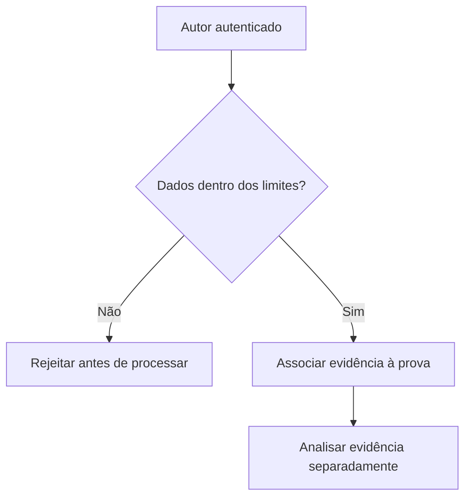

# Evidências, origem e limites de recursos

*Rascunho editorial. Publicação não aprovada.*

## A pergunta

Uma captura de tela pode ajudar a explicar uma disputa, mas antes o sistema precisa responder perguntas mais básicas: quem enviou o arquivo, a qual prova ele pertence, qual é seu tamanho e se pode entrar no fluxo.

## O dilema por trás

Sem limites, evidências se tornam uma superfície de ataque. Um agente malicioso pode enviar arquivos grandes demais, referências em excesso ou dados muito aninhados para consumir recursos antes mesmo de uma análise humana. Os limites precisam ser aplicados antes do processamento custoso, não apenas descritos numa API.

## Nossa direção

No trabalho com OpenProof, definimos políticas para evidências inline e referências armazenadas por provedores, incluindo origem autenticada e cotas acumuladas. Uma decisão de política não significa aplicação completa em todas as rotas e provedores. Vamos publicar valores exatos somente com versão, escopo e estado de implementação verificado.

## O que precisamos verificar

Evidência também não vira verdade por decreto. Um envio válido demonstra que um ator autorizado apresentou dados dentro de certos limites. Saber se esses dados comprovam pagamento, acordo ou conduta inadequada continua sendo uma questão separada para o processo de verificação e disputa.

## Diagrama conceitual

Este diagrama ilustra um princípio de projeto, não um comportamento de execução verificado.

*Referências técnicas e aprovação pendentes.*
