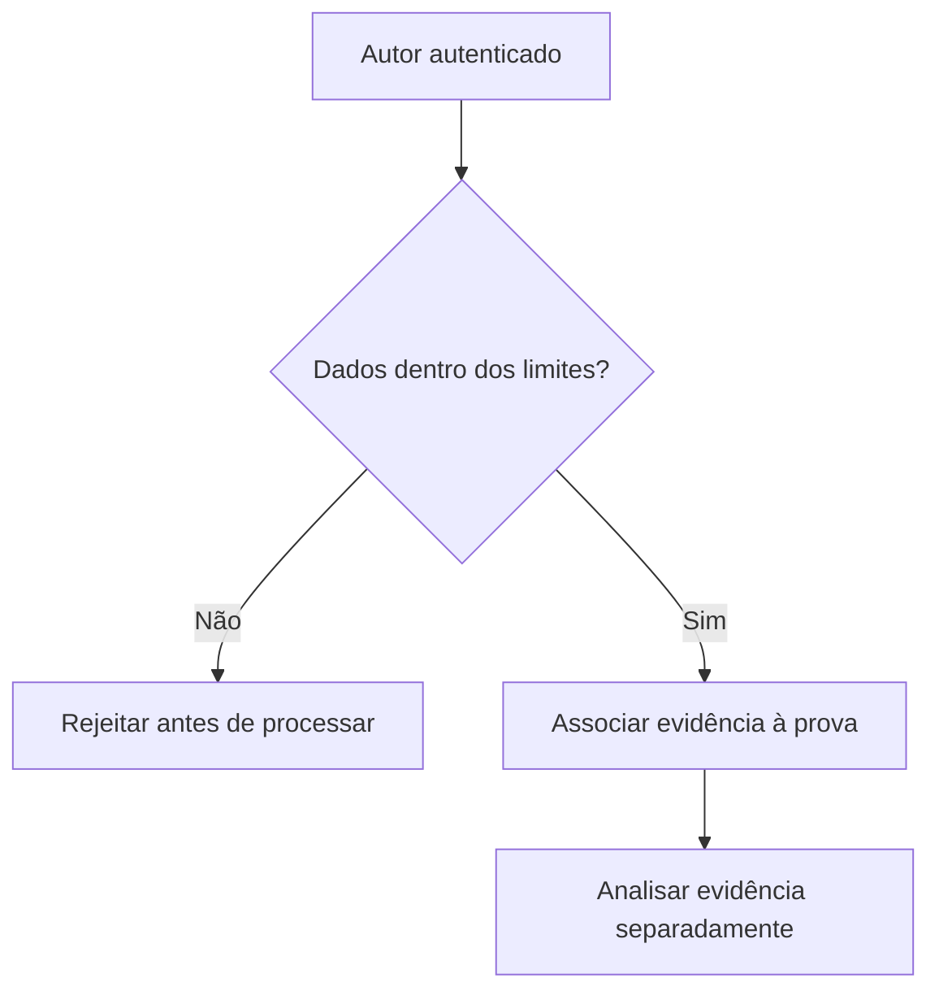

# Evidências, origem e limites de recursos

*Rascunho editorial. Publicação não aprovada.*

## A pergunta

Uma captura de tela pode ajudar a explicar uma disputa, mas antes o sistema precisa responder perguntas mais básicas: quem enviou o arquivo, a qual prova ele pertence, qual é seu tamanho e se pode entrar no fluxo.

## O dilema por trás

Sem limites, evidências se tornam uma superfície de ataque. Um agente malicioso pode enviar arquivos grandes demais, referências em excesso ou dados muito aninhados para consumir recursos antes mesmo de uma análise humana. Os limites precisam ser aplicados antes do processamento custoso, não apenas descritos numa API.

## Nossa direção

No trabalho com OpenProof, definimos políticas para evidências inline e referências armazenadas por provedores, incluindo origem autenticada e cotas acumuladas. Uma decisão de política não significa aplicação completa em todas as rotas e provedores. Vamos publicar valores exatos somente com versão, escopo e estado de implementação verificado.

## O que precisamos verificar

Evidência também não vira verdade por decreto. Um envio válido demonstra que um ator autorizado apresentou dados dentro de certos limites. Saber se esses dados comprovam pagamento, acordo ou conduta inadequada continua sendo uma questão separada para o processo de verificação e disputa.

## Decisão: autenticar a evidência não é autenticar o pagamento

Uma assinatura sobre o digest SHA-256 pode vincular os bytes enviados à chave registrada de quem assina. Não comprova que a transferência retratada aconteceu. O `ProofService.attachEvidence()` examinado verifica acesso à alegação antes de aceitar mídia assinada; o provedor registra metadados de armazenamento, não a verdade independente do pagamento. Uma captura de tela pode ser autêntica e ainda induzir a erro.

## Falha: assinatura correta, alegação errada

Considere uma assinatura válida anexada à prova de outro participante. Validade criptográfica não autoriza o vínculo. A verificação de escopo econômico precisa rejeitar a tentativa antes do armazenamento. Outro ataque usa payloads enormes ou profundamente aninhados: os limites devem ser aplicados antes de canonicalização, hash ou persistência custosos. Definir limites e comprovar seu enforcement no HEAD atual são etapas distintas.

## Diagrama conceitual

Este diagrama ilustra um princípio de projeto, não um comportamento de execução verificado.

## Fronteira comprovada de evidências

Em `ProofService.attachEvidence()`, o serviço verifica primeiro o acesso ao escopo econômico da Claim e depois valida uma assinatura Ed25519 contra a chave registrada do remetente, sobre o digest SHA-256 da mídia. Uma assinatura válida demonstra autoria e integridade dos bytes, **não** que um pagamento bancário ocorreu. O provedor armazena bytes e retorna metadados; metadados não comprovam validade da prova. O filesystem local é implementação de referência, enquanto há um provedor compatível com S3 para armazenamento orientado à produção. Não afirmar cotas Day 0 ou limites inline sem inspecionar os pontos atuais de enforcement.

**Falha:** um usuário assina mídia legítima, mas tenta anexá-la à prova de outra pessoa. A assinatura não autoriza esse ato; a checagem de escopo precisa anteceder a gravação.

### Registro de fontes

- [proof.service.ts](https://github.com/sails-protocol/Sails-Protocol/blob/be6d3bc2ddfc384cfafa4276e01b8aacc096d421/src/modules/open-proof/proof.service.ts)
- [evidence-provider.ts](https://github.com/sails-protocol/Sails-Protocol/blob/be6d3bc2ddfc384cfafa4276e01b8aacc096d421/src/modules/open-proof/evidence-provider.ts)

*Código-fonte inspecionado; verificação externa de pagamento, testes em execução, revisão do CTO e publicação ainda pendentes.*
