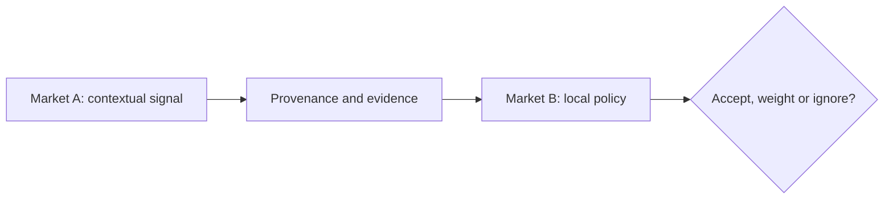

# Reputation: What Can Travel Between Applications?

*Editorial draft. Not approved for publication.*

## The question

A person can build a strong trading history in one marketplace and arrive at another as a stranger. That friction makes portable reputation attractive. But what exactly should move between systems?

## The hidden tradeoff

A number without context can mislead. One hundred completed trades may reflect different amounts, payment methods, dispute policies and verification standards. A negative signal may be accurate, contested or simply irrelevant to another market. Reputation should be examined as a set of claims with provenance and context, not a universal score that everyone must accept.

## Our direction

Our modular roadmap includes OpenReputation and identity-related capabilities. We are exploring how applications might share verifiable signals while retaining their own policies. This remains a design direction, not an announcement of a deployed, universally trusted reputation network.

## What we need to verify

A useful reputation system should let a receiving application ask: who issued this signal, on what evidence, under which rules and when? Portability is valuable only if context travels with the claim.

## Conceptual diagram

This diagram illustrates a design principle, not verified runtime behavior.

*Technical references and approval pending.*
