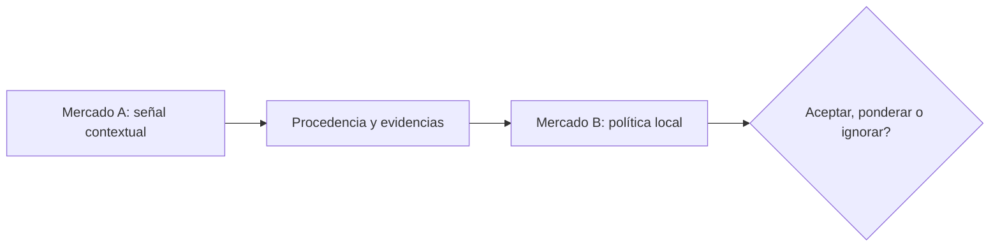

# Reputación: ¿qué puede viajar entre aplicaciones?

*Borrador editorial. Publicación no aprobada.*

## La pregunta

Una persona puede construir un buen historial de operaciones en una plataforma y llegar a otra como desconocida. Esa dificultad hace atractiva la reputación portátil. Pero ¿qué debería circular exactamente entre sistemas?

## El dilema detrás

Un número sin contexto puede engañar. Cien operaciones completadas pueden implicar importes, medios de pago, reglas de disputa y estándares de verificación diferentes. Una señal negativa puede ser correcta, discutida o irrelevante para otro mercado. La reputación debería entenderse como un conjunto de afirmaciones con procedencia y contexto, no como una puntuación universal que todos deban aceptar.

## Nuestra dirección

Nuestra hoja de ruta modular incluye OpenReputation y capacidades relacionadas con la identidad. Estamos explorando cómo las aplicaciones podrían compartir señales verificables y conservar sus propias políticas. Es una dirección de diseño, no el anuncio de una red de reputación universalmente confiable ya desplegada.

## Qué necesitamos verificar

Un sistema útil debería permitir que la aplicación receptora pregunte: ¿quién emitió esta señal, con qué evidencia, bajo qué reglas y cuándo? La portabilidad solo tiene sentido cuando el contexto acompaña la afirmación.

## Diagrama conceptual

Este diagrama ilustra un principio de diseño, no un comportamiento de ejecución verificado.

*Referencias técnicas y aprobación pendientes.*

## Límite respaldado por el código y próxima prueba

El modelo de participantes describe billeteras y agentes; no demuestra reputación portable entre mercados.

**Fallo a evitar:** presentar el límite inspeccionado como garantía de extremo a extremo ya desplegada. **Próxima verificación:** comportamiento en el HEAD exacto, pruebas de integración y evidencia operativa. Solo inspección de código; revisión editorial y del CTO pendientes.

- [RFC-001-participant-model.md](https://github.com/sails-protocol/Sails-Protocol/blob/be6d3bc2ddfc384cfafa4276e01b8aacc096d421/docs/rfcs/RFC-001-participant-model.md)
