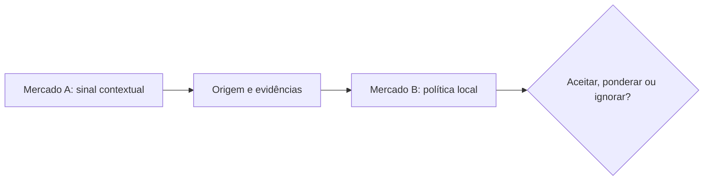

# Reputação: o que pode acompanhar alguém entre aplicações?

*Rascunho editorial. Publicação não aprovada.*

## A pergunta

Uma pessoa pode construir um bom histórico de negociações numa plataforma e chegar a outra como desconhecida. Essa dificuldade torna a reputação portável atraente. Mas o que exatamente deveria circular entre sistemas?

## O dilema por trás

Um número sem contexto pode enganar. Cem negociações concluídas podem envolver valores, meios de pagamento, regras de disputa e padrões de verificação diferentes. Um sinal negativo pode ser correto, contestado ou simplesmente irrelevante para outro mercado. Reputação deve ser vista como um conjunto de afirmações com origem e contexto, não como uma pontuação universal que todos precisam aceitar.

## Nossa direção

Nosso roadmap modular inclui OpenReputation e capacidades relacionadas à identidade. Estamos explorando como aplicações poderiam compartilhar sinais verificáveis sem abrir mão das próprias políticas. Essa é uma direção de projeto, não o anúncio de uma rede de reputação universalmente confiável já em operação.

## O que precisamos verificar

Um sistema útil deveria permitir que a aplicação receptora pergunte: quem emitiu esse sinal, com base em quais evidências, sob quais regras e quando? A portabilidade só faz sentido quando o contexto acompanha a afirmação.

## Diagrama conceitual

Este diagrama ilustra um princípio de projeto, não um comportamento de execução verificado.

*Referências técnicas e aprovação pendentes.*

## Fronteira comprovada no código e próximo teste

O modelo de participantes descreve carteiras e agentes; não comprova portabilidade de reputação entre mercados.

**Falha a evitar:** apresentar a fronteira examinada como garantia de ponta a ponta já implantada. **Próxima verificação:** comportamento no HEAD exato, testes de integração e evidência operacional. Somente inspeção de código; aprovação editorial e do CTO pendentes.

- [RFC-001-participant-model.md](https://github.com/sails-protocol/Sails-Protocol/blob/be6d3bc2ddfc384cfafa4276e01b8aacc096d421/docs/rfcs/RFC-001-participant-model.md)
