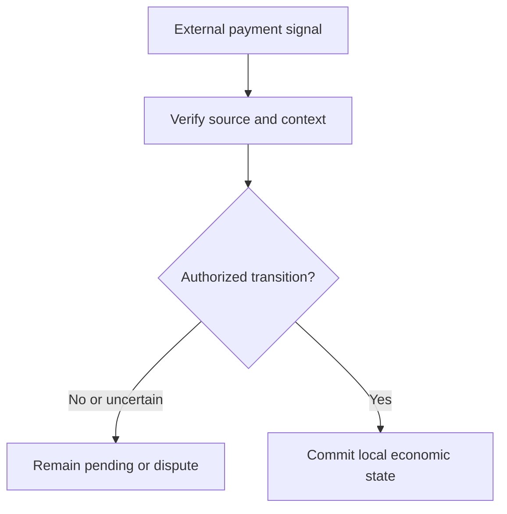

# Settlement, Finality and External Payment Truth

*Editorial draft. Not approved for publication.*

## The uncomfortable question

A buyer says a transfer is complete. A seller says nothing arrived. A payment provider reports a pending status. Which statement should a P2P coordination system treat as final?

## Where assumptions break

There is no single answer that applies to every payment rail. A bank transfer, a blockchain transaction and an internal wallet transfer have different confirmation, reversal and failure properties. Even within one rail, a provider notification can be delayed or wrong. A protocol must not turn an observation into an irreversible economic claim without an explicit authority model.

## Defining authority

That is why we distinguish external signals, authorized decisions and committed state transitions. A receipt is evidence. A provider callback is an observation whose trust level depends on its source and verification. A completed trade is an economic state that must satisfy the workflow's own rules. These concepts may interact, but they are not synonyms.

## What we can responsibly claim

Our Sails engineering work addresses the authority of payment accounts, trade binding, escrow-related transitions and exactly-once local effects. These decisions require evidence at specific persistence and adapter boundaries. A locally atomic transaction does not make an external bank payment irreversible. Any public guarantee must identify the rail, the operation and its verified scope.

## What we need to test

The practical lesson is to keep uncertainty visible. A pending payment should remain pending until the relevant conditions are satisfied. A disputed signal should not silently become a final state. And a failed integration should have a recovery path that does not manufacture certainty.

## Conceptual diagram

The diagram is conceptual and does not establish implemented security guarantees.

*Pending: immutable source references, threat model, verification evidence and CTO approval.*
