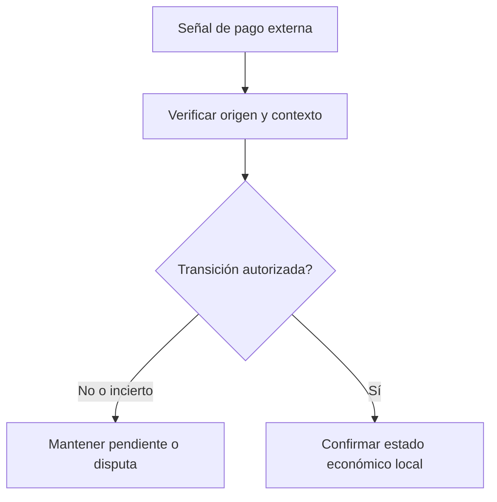

# Liquidación, finalidad y la verdad de los pagos externos

*Borrador editorial. Publicación no aprobada.*

## La pregunta incómoda

El comprador afirma que la transferencia se completó. El vendedor dice que no recibió nada. El proveedor informa que el pago sigue pendiente. ¿Cuál de esas afirmaciones debería considerar definitiva un sistema de coordinación P2P?

## Dónde fallan las suposiciones

No existe una respuesta única para todos los medios de pago. Las transferencias bancarias, las transacciones en blockchain y los movimientos internos de una billetera tienen propiedades diferentes de confirmación, reversión y fallo. Incluso dentro de un mismo medio, una notificación del proveedor puede llegar tarde o ser incorrecta. Un protocolo no debería convertir una observación en una afirmación económica irreversible sin un modelo explícito de autoridad.

## Definir la autoridad

Por eso distinguimos señales externas, decisiones autorizadas y transiciones de estado confirmadas. Un comprobante es una evidencia. Un callback del proveedor es una observación cuya confianza depende de su origen y verificación. Una operación completada es un estado económico que debe cumplir las reglas del flujo. Estos conceptos se relacionan, pero no son sinónimos.

## Qué podemos afirmar con responsabilidad

Nuestro trabajo de ingeniería en Sails aborda la autoridad de las cuentas de pago, su vínculo con operaciones, las transiciones relacionadas con escrow y los efectos locales aplicados una sola vez. Estas decisiones requieren evidencias en límites concretos de persistencia y adaptadores. Una transacción local atómica no vuelve irreversible un pago bancario externo. Cualquier garantía pública debe identificar el medio, la operación y el alcance verificado.

## Qué necesitamos probar

La lección práctica es mantener visible la incertidumbre. Un pago pendiente debe seguir pendiente hasta que se cumplan las condiciones correspondientes. Una señal discutida no puede convertirse silenciosamente en un estado final. Y una integración fallida necesita una ruta de recuperación que no invente certezas.

## Diagrama conceptual

El diagrama es conceptual y no demuestra garantías de seguridad implementadas.

*Pendiente: fuentes inmutables, modelo de amenazas, evidencias de verificación y aprobación del CTO.*

## Límite de liquidación respaldado por el código

El registro de escrow asigna BTC a MULTISIG, LN_BTC a LIGHTNING_HODL basado en Arkade y USDT_ERC20 al proveedor WDK EVM de referencia. Esas asignaciones describen selección de implementación, no finalidad verificada en producción. WDK declara semilla única en el servidor y no aptitud para producción; Arkade documenta alcance de testnet. Multisig Bitcoin describe observación de depósitos externos y recolección independiente de firmas. Hay que distinguir aceptación en la base de datos, transacción reportada por el proveedor, confirmación en cadena y liquidación económica irreversible.

**Escenario adversarial:** el proveedor informa un depósito, pero una reorganización o recibo incompleto invalida el bloqueo supuesto. Existen mecanismos específicos por red, no garantía universal. Antes de afirmar finalidad, exija red, confirmaciones, recibos, pruebas de reinicio y autoridad de liberación.

### Primary source / maturity

- https://github.com/sails-protocol/Sails-Protocol/blob/be6d3bc2ddfc384cfafa4276e01b8aacc096d421/src/modules/open-settlement/escrow-providers.ts
- https://github.com/sails-protocol/Sails-Protocol/blob/be6d3bc2ddfc384cfafa4276e01b8aacc096d421/src/modules/open-settlement/wdk-settlement.provider.ts
- https://github.com/sails-protocol/Sails-Protocol/blob/be6d3bc2ddfc384cfafa4276e01b8aacc096d421/src/modules/open-settlement/lightning-hodl.provider.ts

*Source inspection only; no new live test, CTO approval or publication authorization.*
