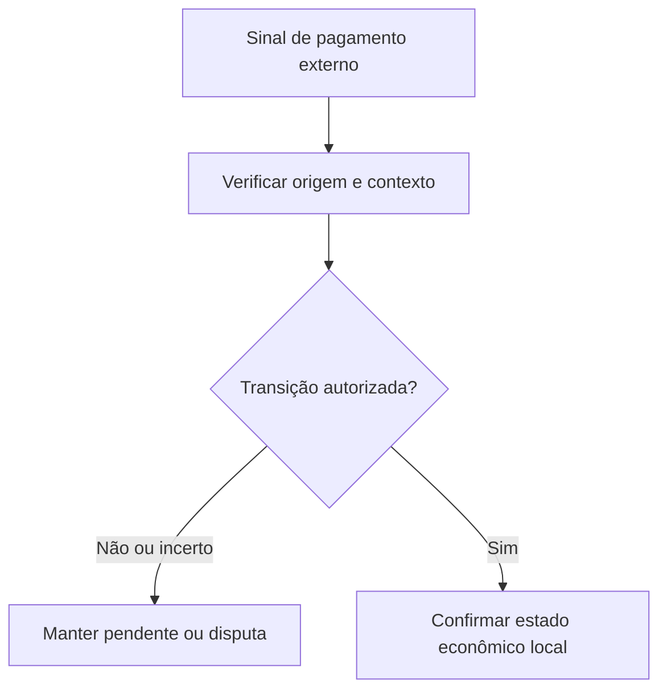

# Liquidação, finalidade e a verdade dos pagamentos externos

*Rascunho editorial. Publicação não aprovada.*

## A pergunta desconfortável

O comprador afirma que a transferência foi concluída. O vendedor diz que não recebeu. O provedor informa que o pagamento está pendente. Qual dessas informações um sistema de coordenação P2P deveria considerar definitiva?

## Onde as premissas falham

Não existe uma resposta única para todos os meios de pagamento. Transferências bancárias, transações em blockchain e transferências internas de carteiras têm regras diferentes de confirmação, reversão e falha. Até dentro de um mesmo meio, a notificação de um provedor pode atrasar ou estar errada. Um protocolo não deve transformar uma observação em uma afirmação econômica irreversível sem um modelo explícito de autoridade.

## Definir a autoridade

Por isso, distinguimos sinais externos, decisões autorizadas e transições de estado confirmadas. Um comprovante é uma evidência. Um callback de provedor é uma observação cuja confiabilidade depende da origem e da verificação. Uma negociação concluída é um estado econômico que precisa obedecer às próprias regras do fluxo. Esses conceitos se relacionam, mas não são sinônimos.

## O que podemos afirmar com responsabilidade

Nosso trabalho de engenharia no Sails trata da autoridade das contas de pagamento, do vínculo com negociações, das transições relacionadas a escrow e dos efeitos locais aplicados uma única vez. Essas decisões exigem evidências nos limites específicos de persistência e adaptadores. Uma transação local atômica não torna irreversível um pagamento bancário externo. Qualquer garantia pública precisa identificar o meio, a operação e o escopo verificado.

## O que precisamos testar

A lição prática é manter a incerteza visível. Um pagamento pendente deve continuar pendente até que as condições necessárias sejam atendidas. Um sinal contestado não pode virar silenciosamente um estado final. E uma integração com falha precisa de um caminho de recuperação que não invente certezas.

## Diagrama conceitual

O diagrama é conceitual e não comprova garantias de segurança implementadas.

*Pendente: fontes imutáveis, modelo de ameaças, evidências de verificação e aprovação do CTO.*

## Fronteira de settlement fundamentada no código

O registro de escrow mapeia BTC para MULTISIG, LN_BTC para LIGHTNING_HODL baseado em Arkade e USDT_ERC20 para o provedor WDK EVM de referência. Esses mapeamentos descrevem a seleção de implementação, não finalidade comprovada em produção. O WDK declara seed única no servidor e inelegibilidade para produção; Arkade documenta escopo de testnet. O multisig Bitcoin descreve observação de depósitos externos e coleta independente de assinaturas. É preciso distinguir aceitação no banco de dados, transação reportada pelo provedor, confirmação na rede e liquidação econômica irreversível.

**Cenário adversarial:** o provedor informa depósito, mas uma reorganização ou recibo incompleto invalida a suposição de bloqueio. Há mecanismos específicos por rede, não garantia universal. Antes de afirmar finalidade, exija rede, confirmações, recibos, testes de reinício e autoridade de liberação.

### Primary source / maturity

- [escrow-providers.ts](https://github.com/sails-protocol/Sails-Protocol/blob/be6d3bc2ddfc384cfafa4276e01b8aacc096d421/src/modules/open-settlement/escrow-providers.ts)
- [wdk-settlement.provider.ts](https://github.com/sails-protocol/Sails-Protocol/blob/be6d3bc2ddfc384cfafa4276e01b8aacc096d421/src/modules/open-settlement/wdk-settlement.provider.ts)
- [lightning-hodl.provider.ts](https://github.com/sails-protocol/Sails-Protocol/blob/be6d3bc2ddfc384cfafa4276e01b8aacc096d421/src/modules/open-settlement/lightning-hodl.provider.ts)

*Source inspection only; no new live test, CTO approval or publication authorization.*
