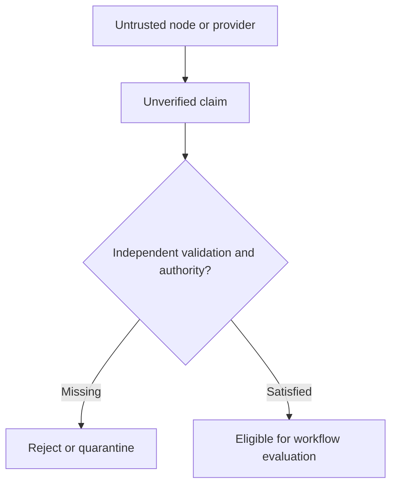

# Designing for Adversarial Nodes and Untrusted Providers

*Editorial draft. Not approved for publication.*

## The uncomfortable question

What happens when a node does not behave as expected? The simplest answer is to assume a bug. A more useful security question is whether the system still protects its economic rules when a participant or service behaves deliberately badly.

## Where assumptions break

A provider may send contradictory responses. A node may omit events, replay old messages or present a misleading view of state. A client may submit validly signed but unauthorized requests. None of these situations should be solved by trusting a friendly name or a successful HTTP response.

## Defining authority

The first defense is a clear trust boundary. Which data is an unverified claim? Which actor can authorize a transition? Which state is durable and authoritative? Which effects require independent confirmation? These questions must be answered per workflow and per adapter, not by a vague statement that the network is decentralized.

## What we can responsibly claim

For Sails Protocol, adversarial-node and malicious-provider scenarios belong in a dedicated red-team validation phase. We can describe the intended security boundaries today, but we must not claim Byzantine fault tolerance, resistance to collusion or production-grade decentralization without the relevant threat model and reproducible tests.

## What we need to test

A good architecture should make it possible to ask uncomfortable questions before an attacker does. Which claims can be forged? What happens if a provider disappears? Can one node hide an economically relevant event? What evidence would demonstrate that a defense actually works? These questions will guide future technical reports as implementation evidence becomes available.

## Conceptual diagram

The diagram is conceptual and does not establish implemented security guarantees.

*Pending: immutable source references, threat model, verification evidence and CTO approval.*
