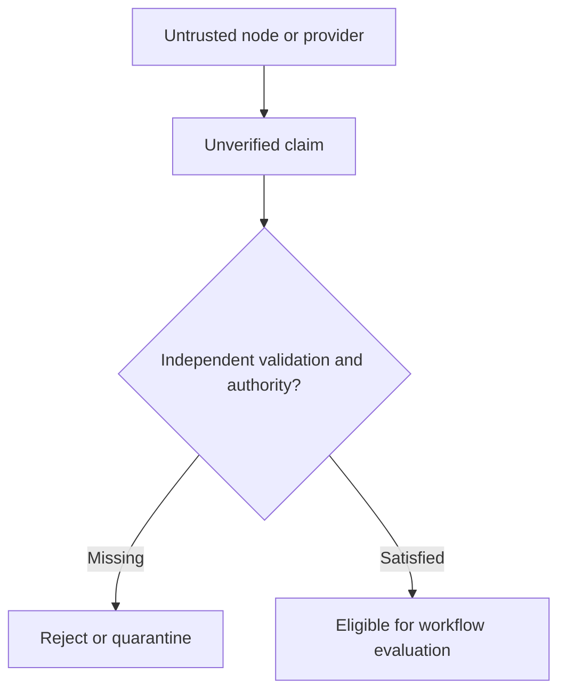

# Designing for Adversarial Nodes and Untrusted Providers

*Editorial draft. Not approved for publication.*

## The uncomfortable question

What happens when a node does not behave as expected? The simplest answer is to assume a bug. A more useful security question is whether the system still protects its economic rules when a participant or service behaves deliberately badly.

## Where assumptions break

A provider may send contradictory responses. A node may omit events, replay old messages or present a misleading view of state. A client may submit validly signed but unauthorized requests. None of these situations should be solved by trusting a friendly name or a successful HTTP response.

## Defining authority

The first defense is a clear trust boundary. Which data is an unverified claim? Which actor can authorize a transition? Which state is durable and authoritative? Which effects require independent confirmation? These questions must be answered per workflow and per adapter, not by a vague statement that the network is decentralized.

## What we can responsibly claim

For Sails Protocol, adversarial-node and malicious-provider scenarios belong in a dedicated red-team validation phase. We can describe the intended security boundaries today, but we must not claim Byzantine fault tolerance, resistance to collusion or production-grade decentralization without the relevant threat model and reproducible tests.

## What we need to test

A good architecture should make it possible to ask uncomfortable questions before an attacker does. Which claims can be forged? What happens if a provider disappears? Can one node hide an economically relevant event? What evidence would demonstrate that a defense actually works? These questions will guide future technical reports as implementation evidence becomes available.

## Decision: treat every provider response as a claim with provenance

A timeout means the outcome may be unknown, not necessarily that the operation failed. A contradictory receipt means two observers disagree, not that the most recent callback automatically wins. A malicious provider can return a plausible success while binding it to the wrong destination. The verification question is whether participants can independently check the chain from **Authority → Outcome → DestinationBinding**, rather than trust an operator's internal association.

The historical Durable Protocol Truth investigation records a residual independent-verification gap, particularly at Outcome → DestinationBinding. The provider-substitution evidence supports selected semantic properties, not a proof that every provider or rail preserves the same economic meaning. These are scoped findings, not evidence that an attack was exploited.

## Failure: success for the wrong destination

Imagine a provider reports a completed settlement with a valid-looking transaction identifier, but the destination associated with the trade is not independently verifiable. Retrying a mutating broadcast after a timeout may compound the risk. A safe integration must preserve the unknown state, reconcile using external evidence, and avoid equating a signed response with proof of the authorized destination. The exact test should compare conflicting provider observations against durable trade authority and independently inspectable settlement data.

## Conceptual diagram

The diagram is conceptual and does not establish implemented security guarantees.

*Pending: immutable source references, threat model, verification evidence and CTO approval.*

## A malicious provider is not just an unavailable provider

The threat model explicitly warns that a protocol invariant is not an inherited deployment mitigation. A malicious operator can lie about provider receipts, omit data, or selectively present its own database associations. The Durable Protocol Truth investigation identifies a missing independently verifiable link between Outcome and DestinationBinding. Provider substitution evidence supports selected economic-meaning properties, not universal provider equivalence or full K3 conformance.

**Adversarial exercise:** replace a settlement provider with one returning plausible but contradictory observations; require independently checkable destination evidence and fail-closed handling. This scenario is a proposed test, not a recorded PASS.

### Source and maturity

- https://github.com/sails-protocol/Sails-Protocol/blob/be6d3bc2ddfc384cfafa4276e01b8aacc096d421/docs/THREAT_MODEL.md
- https://github.com/sails-protocol/Sails-Protocol/blob/be6d3bc2ddfc384cfafa4276e01b8aacc096d421/docs/DURABLE_PROTOCOL_TRUTH_EVIDENCE.md
- https://github.com/sails-protocol/Sails-Protocol/blob/be6d3bc2ddfc384cfafa4276e01b8aacc096d421/docs/PROVIDER_SUBSTITUTION_INVARIANCE_EVIDENCE.md

*Historical evidence/source inspection only; no latest-head test or publication approval.*
