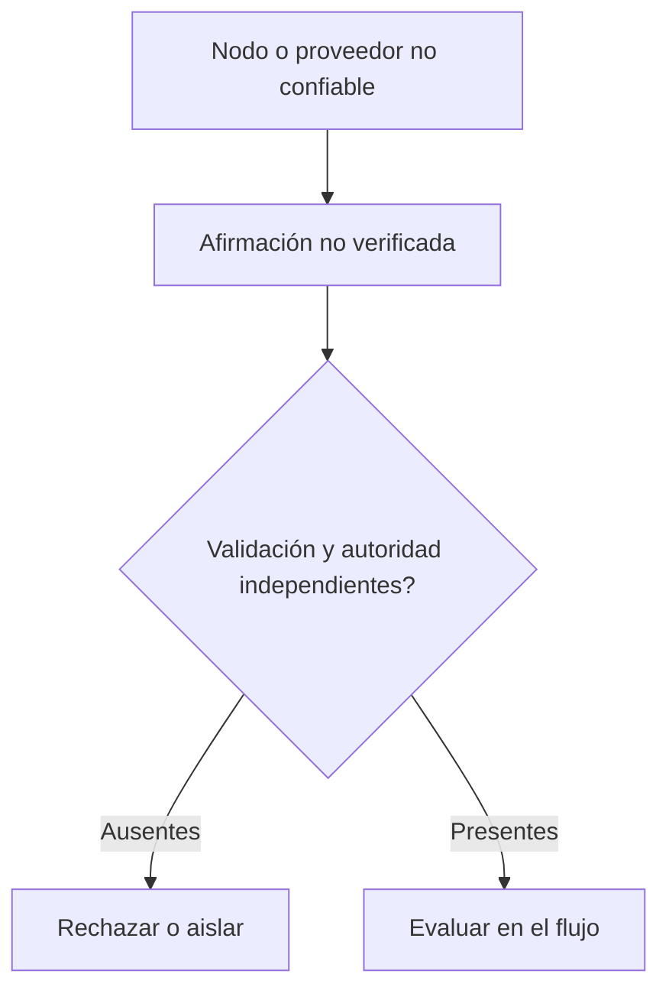

# Diseñar para nodos adversarios y proveedores no confiables

*Borrador editorial. Publicación no aprobada.*

## La pregunta incómoda

¿Qué ocurre cuando un nodo no se comporta como se espera? La respuesta más simple es suponer un error. Una pregunta de seguridad más útil es si el sistema sigue protegiendo sus reglas económicas cuando un participante o servicio actúa deliberadamente de mala fe.

## Dónde fallan las suposiciones

Un proveedor puede enviar respuestas contradictorias. Un nodo puede omitir eventos, repetir mensajes antiguos o presentar una visión engañosa del estado. Un cliente puede enviar solicitudes firmadas correctamente, pero sin autorización. Ninguna de estas situaciones debería resolverse confiando en un nombre conocido o en una respuesta HTTP exitosa.

## Definir la autoridad

La primera defensa es un límite de confianza claro. ¿Qué dato es solo una afirmación no verificada? ¿Qué actor puede autorizar una transición? ¿Qué estado es duradero y tiene autoridad? ¿Qué efectos requieren confirmación independiente? Estas preguntas deben responderse por flujo y adaptador, no con una afirmación vaga de que la red es descentralizada.

## Qué podemos afirmar con responsabilidad

Para Sails Protocol, los escenarios de nodos adversarios y proveedores maliciosos pertenecen a una fase específica de validación red team. Podemos explicar los límites de seguridad previstos hoy, pero no debemos afirmar tolerancia a fallos bizantinos, resistencia a la colusión ni descentralización lista para producción sin un modelo de amenazas y pruebas reproducibles.

## Qué necesitamos probar

Una buena arquitectura debe permitir preguntas incómodas antes de que las haga un atacante. ¿Qué afirmaciones pueden falsificarse? ¿Qué pasa si desaparece un proveedor? ¿Puede un nodo ocultar un evento económicamente relevante? ¿Qué evidencia demostraría que una defensa funciona de verdad? Estas preguntas guiarán futuros informes técnicos a medida que haya evidencias de implementación.

## Diagrama conceptual

El diagrama es conceptual y no demuestra garantías de seguridad implementadas.

*Pendiente: fuentes inmutables, modelo de amenazas, evidencias de verificación y aprobación del CTO.*

## Un proveedor malicioso no es solo un proveedor caído

El modelo de amenazas advierte que una invariante del protocolo no implica mitigación automática en cada despliegue. Un operador malicioso puede falsear recibos, omitir datos o seleccionar asociaciones de su base. Durable Protocol Truth identifica falta de vínculo verificable de forma independiente entre Outcome y DestinationBinding. La evidencia de sustitución de proveedores respalda propiedades económicas seleccionadas, no equivalencia universal ni conformidad K3 completa.

**Prueba adversarial:** sustituir un proveedor por otro que devuelva observaciones plausibles pero contradictorias y exigir evidencia independiente del destino y cierre seguro. Es una prueba propuesta, no un PASS.

### Source and maturity

- https://github.com/sails-protocol/Sails-Protocol/blob/be6d3bc2ddfc384cfafa4276e01b8aacc096d421/docs/THREAT_MODEL.md
- https://github.com/sails-protocol/Sails-Protocol/blob/be6d3bc2ddfc384cfafa4276e01b8aacc096d421/docs/DURABLE_PROTOCOL_TRUTH_EVIDENCE.md
- https://github.com/sails-protocol/Sails-Protocol/blob/be6d3bc2ddfc384cfafa4276e01b8aacc096d421/docs/PROVIDER_SUBSTITUTION_INVARIANCE_EVIDENCE.md

*Historical evidence/source inspection only; no latest-head test or publication approval.*
