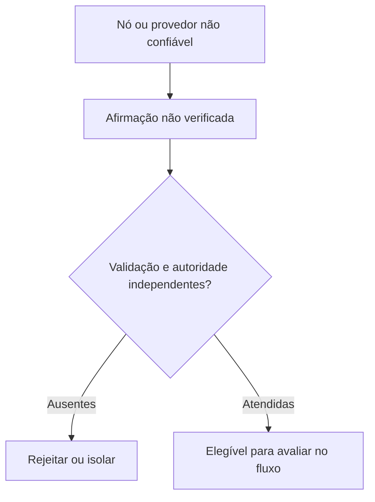

# Projetando para nós adversariais e provedores não confiáveis

*Rascunho editorial. Publicação não aprovada.*

## A pergunta desconfortável

O que acontece quando um nó não se comporta como esperado? A resposta mais simples é presumir um bug. Uma pergunta de segurança mais útil é se o sistema continua protegendo suas regras econômicas quando um participante ou serviço age deliberadamente de má-fé.

## Onde as premissas falham

Um provedor pode enviar respostas contraditórias. Um nó pode omitir eventos, repetir mensagens antigas ou apresentar uma visão enganosa do estado. Um cliente pode enviar requisições assinadas corretamente, mas sem autorização. Nenhuma dessas situações deve ser resolvida confiando num nome conhecido ou numa resposta HTTP de sucesso.

## Definir a autoridade

A primeira defesa é um limite de confiança claro. Qual dado é apenas uma afirmação não verificada? Qual ator pode autorizar uma transição? Qual estado é durável e tem autoridade? Quais efeitos exigem confirmação independente? Essas perguntas precisam ser respondidas por fluxo e adaptador, não com uma declaração vaga de que a rede é descentralizada.

## O que podemos afirmar com responsabilidade

Para o Sails Protocol, cenários de nós adversariais e provedores maliciosos pertencem a uma fase dedicada de validação red team. Podemos explicar os limites de segurança pretendidos hoje, mas não devemos afirmar tolerância a falhas bizantinas, resistência a conluio ou descentralização pronta para produção sem um modelo de ameaças e testes reproduzíveis.

## O que precisamos testar

Uma boa arquitetura precisa permitir perguntas desconfortáveis antes que um atacante as faça. Quais afirmações podem ser falsificadas? O que acontece se um provedor desaparecer? Um nó consegue esconder um evento economicamente relevante? Qual evidência demonstraria que uma defesa funciona de verdade? Essas perguntas orientarão futuros relatórios técnicos conforme surgirem evidências de implementação.

## Diagrama conceitual

O diagrama é conceitual e não comprova garantias de segurança implementadas.

*Pendente: fontes imutáveis, modelo de ameaças, evidências de verificação e aprovação do CTO.*

## Provedor malicioso não é apenas provedor indisponível

O modelo de ameaças alerta que um invariante do protocolo não significa mitigação automaticamente implementada em cada deployment. Um operador malicioso pode mentir sobre recibos, omitir dados ou selecionar associações de seu banco. A investigação Durable Protocol Truth aponta falta de vínculo independentemente verificável entre Outcome e DestinationBinding. A evidência de substituição de provedores sustenta propriedades econômicas selecionadas, não equivalência universal nem conformidade K3 integral.

**Teste adversarial:** substituir um provedor por outro que devolve observações plausíveis, porém contraditórias, e exigir evidência independente do destino e falha segura. É teste proposto, não PASS.

### Source and maturity

- https://github.com/sails-protocol/Sails-Protocol/blob/be6d3bc2ddfc384cfafa4276e01b8aacc096d421/docs/THREAT_MODEL.md
- https://github.com/sails-protocol/Sails-Protocol/blob/be6d3bc2ddfc384cfafa4276e01b8aacc096d421/docs/DURABLE_PROTOCOL_TRUTH_EVIDENCE.md
- https://github.com/sails-protocol/Sails-Protocol/blob/be6d3bc2ddfc384cfafa4276e01b8aacc096d421/docs/PROVIDER_SUBSTITUTION_INVARIANCE_EVIDENCE.md

*Historical evidence/source inspection only; no latest-head test or publication approval.*
