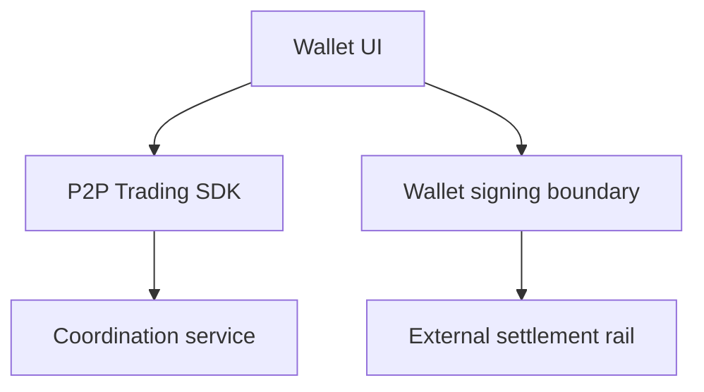

# Integrating P2P Trading into a Wallet

*Editorial draft. Not approved for publication.*

## The problem

A wallet knows how to show balances and prepare transactions. A P2P trade needs more: two participants, a shared state, payment evidence and rules for disagreement. Putting a trade button on a wallet screen does not solve those problems.

## The boundary

The Sails P2P Trading SDK is intended to expose coordination workflows while the wallet retains responsibility for user experience, signing and asset custody. The integration must define which identity acts, how a trade is authorized, what is signed and which external settlement adapter is trusted. No SDK should silently gain access to a user's seed or funds.

## What remains to be proven

Satsails Wallet is a separate wallet product and a prospective integration environment, not another name for Sails Protocol. A reference integration will need to prove its behavior on the exact supported networks and payment rails. A conceptual flow cannot establish that a specific asset or chain works in production.

## Conceptual diagram

Text equivalent: the diagram shows the responsibility boundaries discussed above, not verified deployment.

*Source references, technical review and owner publication approval pending.*

## Source-backed boundary and next test

The inspected SDK exposes trade creation with an optional idempotency key; wallet custody and signing guarantees need separate evidence.

**Failure to avoid:** presenting this inspected boundary as a deployed end-to-end guarantee. **Next verification:** exact-head behavior, integration tests and operational evidence. Source inspection only; editorial and CTO approval pending.

- [openp2p.ts](https://github.com/sails-protocol/Sails-Protocol/blob/be6d3bc2ddfc384cfafa4276e01b8aacc096d421/packages/sails-sdk/src/modules/openp2p.ts)
