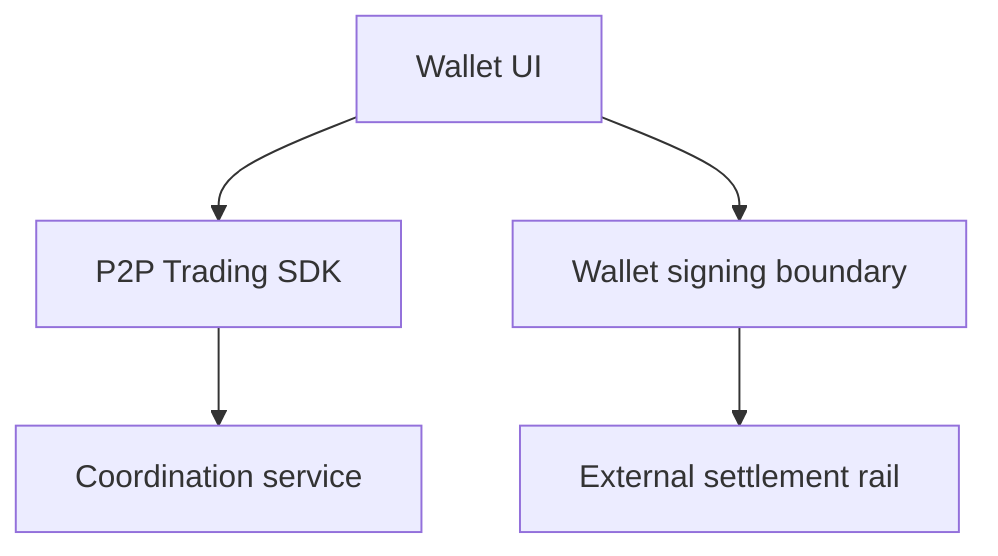

# Integrating P2P Trading into a Wallet

*Editorial draft. Not approved for publication.*

## The problem

A wallet knows how to show balances and prepare transactions. A P2P trade needs more: two participants, a shared state, payment evidence and rules for disagreement. Putting a trade button on a wallet screen does not solve those problems.

## The boundary

The Sails P2P Trading SDK is intended to expose coordination workflows while the wallet retains responsibility for user experience, signing and asset custody. The integration must define which identity acts, how a trade is authorized, what is signed and which external settlement adapter is trusted. No SDK should silently gain access to a user's seed or funds.

## What remains to be proven

Satsails Wallet is a separate wallet product and a prospective integration environment, not another name for Sails Protocol. A reference integration will need to prove its behavior on the exact supported networks and payment rails. A conceptual flow cannot establish that a specific asset or chain works in production.

## Conceptual diagram

Text equivalent: the diagram shows the responsibility boundaries discussed above, not verified deployment.

*Source references, technical review and owner publication approval pending.*

## A failed-response trade is not a harmless retry

Consider a buyer tapping **Create trade** in a wallet. The coordination service persists the trade, but the response is lost before the wallet receives the identifier. The buyer taps again. If the second request uses a new idempotency key, or no key at all, the service may interpret it as a distinct economic intention. A wallet's familiar retry spinner can therefore create a second trade rather than recover the first.

The integration should generate a stable key for one user intention, retain it across transport retries, and reconcile an uncertain response before offering a new attempt. That is an application-level obligation, not a property conferred merely by importing the SDK. The inspected optional argument shows an available mechanism, not proof that a particular wallet uses it correctly.

A second boundary appears when the wallet is asked to sign. The trade identifier, participant authority, asset, network, amount, destination and settlement conditions must be checked against what the user actually approved. A valid signature over the wrong trade context is not valid authorization for the intended trade. Coordination records cannot substitute for the external network's settlement result.

The practical choice is to keep the wallet's signing and key material outside the coordination SDK, while making retry identity and approval context explicit at the integration edge. This adds recovery and confirmation work to the wallet UX, but avoids silently treating a transport retry or generic signature as economic consent.

**Next question:** can an exact-head integration test reproduce a persisted trade with a lost response, recover the same trade after retry, and show that mismatched signing context is rejected without a second economic effect? Until such a test is recorded, this remains an integration requirement rather than a verified guarantee.

## Source-backed boundary and next test

The inspected SDK exposes trade creation with an optional idempotency key; wallet custody and signing guarantees need separate evidence.

**Failure to avoid:** presenting this inspected boundary as a deployed end-to-end guarantee. **Next verification:** exact-head behavior, integration tests and operational evidence. Source inspection only; editorial and CTO approval pending.

- [openp2p.ts](https://github.com/sails-protocol/Sails-Protocol/blob/be6d3bc2ddfc384cfafa4276e01b8aacc096d421/packages/sails-sdk/src/modules/openp2p.ts)
