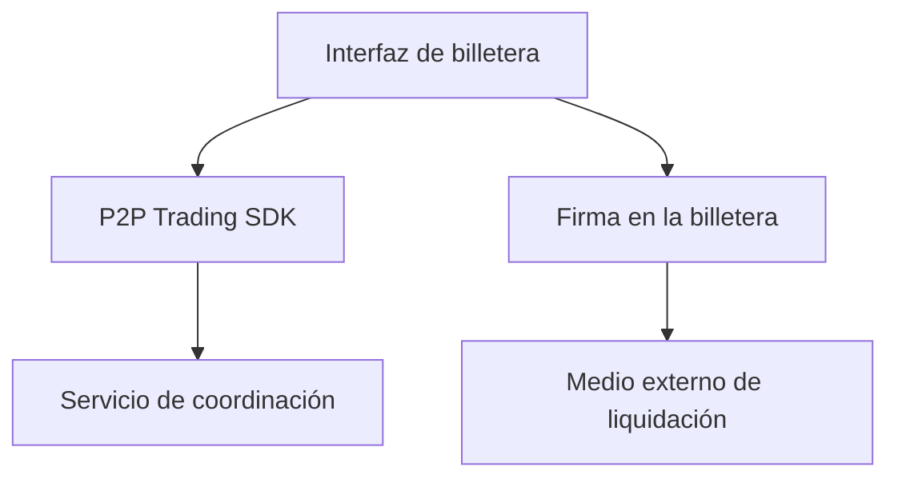

# Integrar operaciones P2P en una billetera

*Borrador editorial. Publicación no aprobada.*

## El problema

Una billetera muestra saldos y prepara transacciones. Una operación P2P exige más: dos participantes, estado compartido, evidencias de pago y reglas para desacuerdos. Añadir un botón de negociación no resuelve esos problemas.

## El límite

Sails P2P Trading SDK busca ofrecer flujos de coordinación mientras la billetera mantiene la responsabilidad de la experiencia, las firmas y la custodia de activos. La integración debe definir qué identidad actúa, cómo se autoriza una operación, qué se firma y en qué adaptador de liquidación se confía. Ningún SDK debería obtener acceso silencioso a la semilla ni a los fondos.

## Qué falta demostrar

Satsails Wallet es un producto de billetera independiente y un entorno previsto de integración, no otro nombre de Sails Protocol. Una integración de referencia deberá demostrar su comportamiento en las redes y medios de pago realmente admitidos. Un flujo conceptual no prueba que un activo o una red funcionen en producción.

## Diagrama conceptual

Equivalente textual: el diagrama muestra los límites de responsabilidad descritos arriba, no un despliegue verificado.

*Se incluye más abajo una referencia inmutable al SDK. Siguen pendientes la verificación completa de las afirmaciones frente a las fuentes, la revisión técnica y la aprobación de publicación.*

## Una respuesta perdida no convierte el reintento en una operación segura

Imaginemos que el comprador pulsa **Crear operación**. El servicio registra la operación, pero la respuesta se pierde antes de que la billetera reciba su identificador. El comprador vuelve a intentarlo. Si la nueva solicitud usa otra clave de idempotencia, o ninguna, el servicio puede interpretarla como una segunda intención económica. Un botón de reintento puede terminar creando otra operación.

La integración debe generar una clave estable por intención del usuario, conservarla entre reintentos de transporte y reconciliar las respuestas inciertas antes de permitir una nueva operación. Esa obligación pertenece a la aplicación. El argumento opcional observado en el SDK demuestra un mecanismo disponible, no que una billetera concreta lo utilice correctamente.

Hay otro límite al solicitar la firma. El identificador de la operación, la autoridad del participante, el activo, la red, el importe, el destino y las condiciones de liquidación deben coincidir con lo que el usuario aprobó. Una firma criptográficamente válida sobre un contexto equivocado no autoriza la operación pretendida. El registro del coordinador tampoco sustituye el resultado de liquidación observado en la red externa.

La decisión de integración es mantener las claves y las firmas bajo control de la billetera, y hacer explícitas la identidad de los reintentos y el contexto de aprobación. Esto añade trabajo a la experiencia de recuperación, pero evita convertir un reintento de red o una firma genérica en consentimiento económico.

**Siguiente pregunta:** ¿puede una prueba de integración sobre el HEAD exacto simular una operación persistida cuya respuesta se perdió, recuperar la misma operación al reintentar y rechazar un contexto de firma distinto sin un segundo efecto económico? Hasta registrar esa evidencia, sigue siendo un requisito, no una garantía verificada.

## Límite respaldado por el código y próxima prueba

El SDK inspeccionado expone creación de operaciones con clave de idempotencia opcional; custodia y firma requieren pruebas separadas.

**Fallo a evitar:** presentar el límite inspeccionado como garantía de extremo a extremo ya desplegada. **Próxima verificación:** comportamiento en el HEAD exacto, pruebas de integración y evidencia operativa. Solo inspección de código; revisión editorial y del CTO pendientes.

- [openp2p.ts](https://github.com/sails-protocol/Sails-Protocol/blob/be6d3bc2ddfc384cfafa4276e01b8aacc096d421/packages/sails-sdk/src/modules/openp2p.ts)
