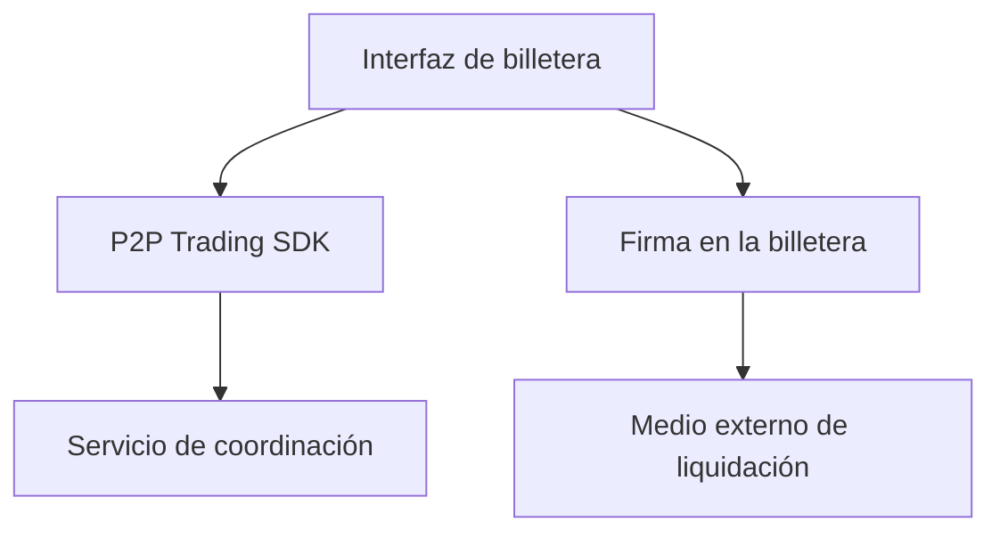

# Integrar operaciones P2P en una billetera

*Borrador editorial. Publicación no aprobada.*

## El problema

Una billetera muestra saldos y prepara transacciones. Una operación P2P exige más: dos participantes, estado compartido, evidencias de pago y reglas para desacuerdos. Añadir un botón de negociación no resuelve esos problemas.

## El límite

Sails P2P Trading SDK busca ofrecer flujos de coordinación mientras la billetera mantiene la responsabilidad de la experiencia, las firmas y la custodia de activos. La integración debe definir qué identidad actúa, cómo se autoriza una operación, qué se firma y en qué adaptador de liquidación se confía. Ningún SDK debería obtener acceso silencioso a la semilla ni a los fondos.

## Qué falta demostrar

Satsails Wallet es un producto de billetera independiente y un entorno previsto de integración, no otro nombre de Sails Protocol. Una integración de referencia deberá demostrar su comportamiento en las redes y medios de pago realmente admitidos. Un flujo conceptual no prueba que un activo o una red funcionen en producción.

## Diagrama conceptual

Equivalente textual: el diagrama muestra los límites de responsabilidad descritos arriba, no un despliegue verificado.

*Referencias, revisión técnica y aprobación del responsable de publicación pendientes.*

## Límite respaldado por el código y próxima prueba

El SDK inspeccionado expone creación de operaciones con clave de idempotencia opcional; custodia y firma requieren pruebas separadas.

**Fallo a evitar:** presentar el límite inspeccionado como garantía de extremo a extremo ya desplegada. **Próxima verificación:** comportamiento en el HEAD exacto, pruebas de integración y evidencia operativa. Solo inspección de código; revisión editorial y del CTO pendientes.

- [openp2p.ts](https://github.com/sails-protocol/Sails-Protocol/blob/be6d3bc2ddfc384cfafa4276e01b8aacc096d421/packages/sails-sdk/src/modules/openp2p.ts)
