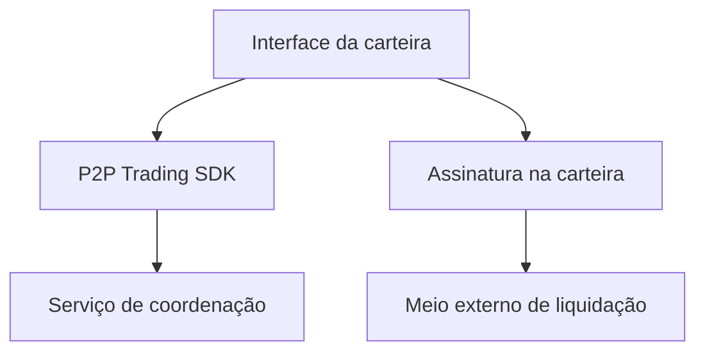

# Integrando negociações P2P a uma carteira

*Rascunho editorial. Publicação não aprovada.*

## O problema

Uma carteira mostra saldos e prepara transações. Uma negociação P2P exige mais: dois participantes, estado compartilhado, evidências de pagamento e regras para divergências. Colocar um botão de negociação na tela não resolve esses problemas.

## O limite

O Sails P2P Trading SDK pretende disponibilizar fluxos de coordenação enquanto a carteira continua responsável pela experiência, assinatura e custódia dos ativos. A integração precisa definir qual identidade atua, como uma negociação é autorizada, o que é assinado e em qual adaptador de liquidação se confia. Nenhum SDK deveria receber acesso silencioso à seed ou aos fundos.

## O que ainda precisa ser comprovado

Satsails Wallet é um produto de carteira separado e um ambiente previsto de integração, não outro nome para Sails Protocol. Uma integração de referência precisará comprovar seu comportamento nas redes e meios de pagamento realmente suportados. Um fluxo conceitual não prova que determinado ativo ou rede funciona em produção.

## Diagrama conceitual

Equivalente textual: o diagrama mostra os limites de responsabilidade descritos acima, não uma implantação verificada.

*Referências, revisão técnica e aprovação do responsável pela publicação pendentes.*
