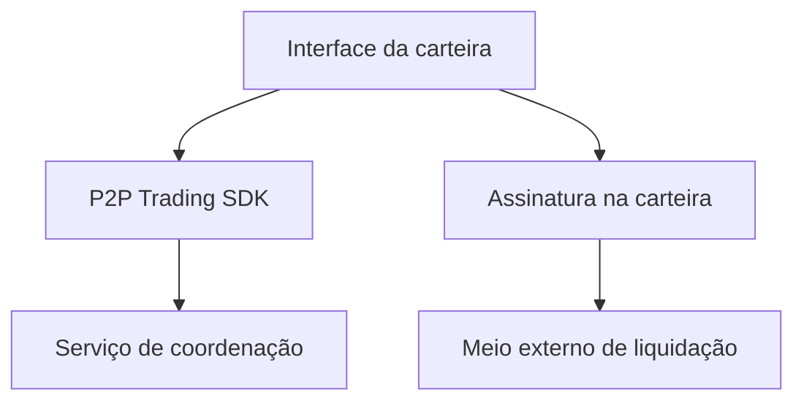

# Integrando negociações P2P a uma carteira

*Rascunho editorial. Publicação não aprovada.*

## O problema

Uma carteira mostra saldos e prepara transações. Uma negociação P2P exige mais: dois participantes, estado compartilhado, evidências de pagamento e regras para divergências. Colocar um botão de negociação na tela não resolve esses problemas.

## O limite

O Sails P2P Trading SDK pretende disponibilizar fluxos de coordenação enquanto a carteira continua responsável pela experiência, assinatura e custódia dos ativos. A integração precisa definir qual identidade atua, como uma negociação é autorizada, o que é assinado e em qual adaptador de liquidação se confia. Nenhum SDK deveria receber acesso silencioso à seed ou aos fundos.

## O que ainda precisa ser comprovado

Satsails Wallet é um produto de carteira separado e um ambiente previsto de integração, não outro nome para Sails Protocol. Uma integração de referência precisará comprovar seu comportamento nas redes e meios de pagamento realmente suportados. Um fluxo conceitual não prova que determinado ativo ou rede funciona em produção.

## Diagrama conceitual

Equivalente textual: o diagrama mostra os limites de responsabilidade descritos acima, não uma implantação verificada.

*Há uma referência imutável ao SDK abaixo. A verificação completa das afirmações contra as fontes, a revisão técnica e a aprovação para publicação continuam pendentes.*

## Quando a resposta se perde, repetir não é necessariamente seguro

Imagine o comprador tocando em **Criar negociação**. O serviço registra a negociação, mas a resposta se perde antes de a carteira receber seu identificador. O comprador tenta novamente. Se a nova chamada usar outra chave de idempotência, ou nenhuma, o serviço pode entender que existe uma segunda intenção econômica. Um simples botão de tentar novamente pode, portanto, criar outra negociação.

A integração deve gerar uma chave estável para cada intenção do usuário, preservá-la nas tentativas de transporte e reconciliar respostas incertas antes de permitir uma nova operação. Essa responsabilidade é da aplicação. O argumento opcional encontrado no SDK demonstra um mecanismo disponível, não que uma carteira específica o utilize corretamente.

Existe outra fronteira no momento da assinatura. Identificador da negociação, autoridade do participante, ativo, rede, valor, destino e condições de liquidação precisam corresponder ao que o usuário aprovou. Uma assinatura criptograficamente válida associada ao contexto errado não autoriza a negociação pretendida. O estado registrado pelo coordenador também não substitui o resultado observado na rede de liquidação.

A decisão de integração é manter as chaves e a assinatura sob controle da carteira e tornar explícitos a identidade das tentativas e o contexto de aprovação. Isso exige mais cuidado na experiência de recuperação, mas evita transformar uma repetição de rede ou uma assinatura genérica em consentimento econômico.

**Próxima pergunta:** um teste de integração no HEAD exato consegue simular uma negociação persistida com resposta perdida, recuperar a mesma negociação na repetição e rejeitar um contexto de assinatura divergente sem segundo efeito econômico? Até existir essa evidência, trata-se de um requisito, não de uma garantia verificada.

## Fronteira comprovada no código e próximo teste

O SDK examinado oferece criação de negociação com chave de idempotência opcional; custódia e assinatura da carteira exigem provas separadas.

**Falha a evitar:** apresentar a fronteira examinada como garantia de ponta a ponta já implantada. **Próxima verificação:** comportamento no HEAD exato, testes de integração e evidência operacional. Somente inspeção de código; aprovação editorial e do CTO pendentes.

- [openp2p.ts](https://github.com/sails-protocol/Sails-Protocol/blob/be6d3bc2ddfc384cfafa4276e01b8aacc096d421/packages/sails-sdk/src/modules/openp2p.ts)
