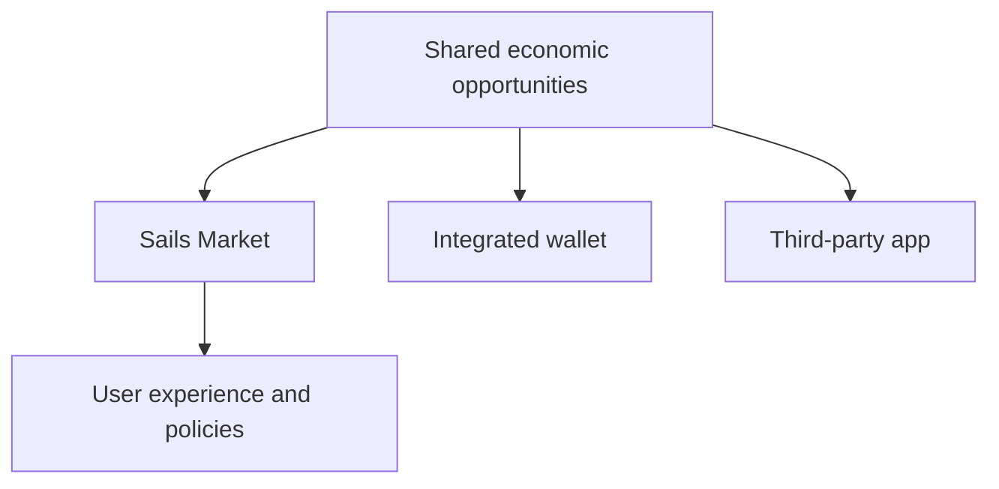

# Why a Reference Market Should Not Own Its Own Liquidity

*Editorial draft. Not approved for publication.*

## The problem

Imagine a wallet and a web market displaying different opportunities even though both connect to the same trading ecosystem. If every interface builds its own isolated liquidity pool, participants face fragmentation rather than a shared market.

## The boundary

Our direction for Sails Market is a reference web application that consumes the same underlying economic opportunities available to integrated wallets and third parties. The market may present offers, organize private rooms and connect external services without pretending that all those services are native Sails Protocol modules.

## What remains to be proven

Shared visibility does not guarantee execution or depth. Liquidity depends on counterparties, routing, availability, pricing and permission rules. A reference application should expose those constraints honestly, including when a particular opportunity is unavailable to a user or payment method.

## Conceptual diagram

Text equivalent: the diagram shows the responsibility boundaries discussed above, not verified deployment.

*Source references, technical review and owner publication approval pending.*

## Evidence boundary and failure mode

Selected provider-substitution properties do not establish universal shared liquidity or an operational market. **Failure:** interpreting this architectural or source-inspected statement as current production verification. Exact-head tests and approval are still required.

- [PROVIDER_SUBSTITUTION_INVARIANCE_EVIDENCE.md](https://github.com/sails-protocol/Sails-Protocol/blob/be6d3bc2ddfc384cfafa4276e01b8aacc096d421/docs/PROVIDER_SUBSTITUTION_INVARIANCE_EVIDENCE.md)
