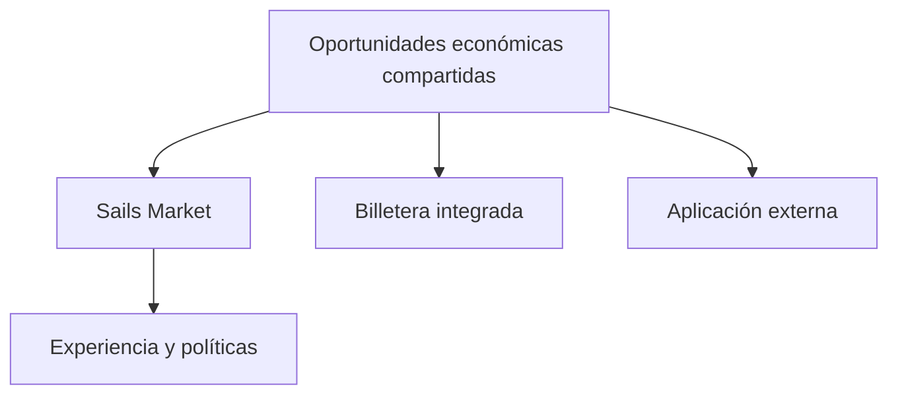

# Por qué un mercado de referencia no debería aislar su liquidez

*Borrador editorial. Publicación no aprobada.*

## El problema

Imaginemos una billetera y un mercado web mostrando oportunidades diferentes aunque participen del mismo ecosistema. Si cada interfaz crea liquidez aislada, los participantes se encuentran con fragmentación en lugar de un mercado compartido.

## El límite

Nuestra dirección para Sails Market es una aplicación web de referencia que consume las mismas oportunidades económicas disponibles para billeteras integradas y terceros. El mercado puede mostrar ofertas, organizar salas privadas y conectar servicios externos sin presentar todos esos servicios como módulos nativos de Sails Protocol.

## Qué falta demostrar

La visibilidad compartida no garantiza ejecución ni profundidad de mercado. La liquidez depende de contrapartes, rutas, disponibilidad, precios y permisos. Una aplicación de referencia debe mostrar esas limitaciones con claridad, incluso cuando una oportunidad no está disponible para cierto usuario o medio de pago.

## Diagrama conceptual

Equivalente textual: el diagrama muestra los límites de responsabilidad descritos arriba, no un despliegue verificado.

*Referencias, revisión técnica y aprobación del responsable de publicación pendientes.*
