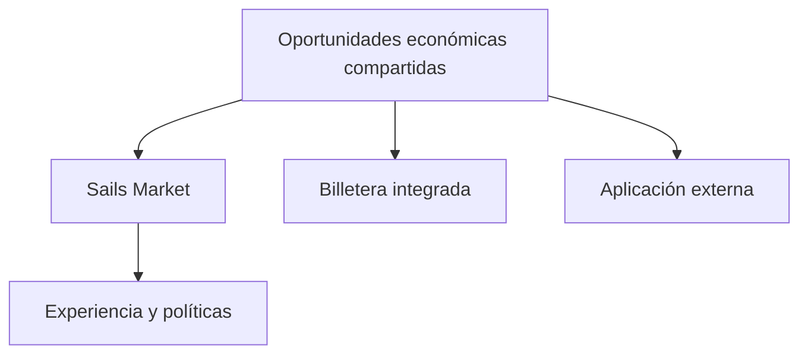

# Por qué un mercado de referencia no debería aislar su liquidez

*Borrador editorial. Publicación no aprobada.*

## El problema

Imaginemos una billetera y un mercado web mostrando oportunidades diferentes aunque participen del mismo ecosistema. Si cada interfaz crea liquidez aislada, los participantes se encuentran con fragmentación en lugar de un mercado compartido.

## El límite

Nuestra dirección para Sails Market es una aplicación web de referencia que consume las mismas oportunidades económicas disponibles para billeteras integradas y terceros. El mercado puede mostrar ofertas, organizar salas privadas y conectar servicios externos sin presentar todos esos servicios como módulos nativos de Sails Protocol.

## Qué falta demostrar

La visibilidad compartida no garantiza ejecución ni profundidad de mercado. La liquidez depende de contrapartes, rutas, disponibilidad, precios y permisos. Una aplicación de referencia debe mostrar esas limitaciones con claridad, incluso cuando una oportunidad no está disponible para cierto usuario o medio de pago.

## Diagrama conceptual

Equivalente textual: el diagrama muestra los límites de responsabilidad descritos arriba, no un despliegue verificado.

*Referencias, revisión técnica y aprobación del responsable de publicación pendientes.*

## Una oferta desactualizada no es liquidez ejecutable

Dos aplicaciones pueden mostrar la misma oferta aunque solo una persona pueda aceptar la capacidad restante. Si la billetera acepta primero, Sails Market no debe tratar su pantalla desactualizada como una reserva. El descubrimiento compartido es distinto de la elegibilidad, la aceptación y la liquidación. El método de pago, los permisos de la contraparte, la caducidad de la cotización y la capacidad disponible deben volver a comprobarse en el límite autoritativo. Una sala privada controla el acceso, no la verdad económica; los proveedores externos conservan sus propias reglas de ejecución.

El compromiso es rechazar ocasionalmente una cotización vencida en lugar de inventar una ejecución. La experiencia de liquidez compartida propuesta sigue siendo un objetivo de diseño, no una prueba de que exista un libro de órdenes universal desplegado. **Siguiente prueba:** hacer que dos clientes compitan por la última capacidad y comprobar que el segundo recibe un rechazo o una actualización sin generar un compromiso económico duplicado.

## Límite de evidencia y fallo

Propiedades seleccionadas de sustitución de proveedores no prueban liquidez compartida universal ni mercado operativo. **Fallo:** interpretar arquitectura o código inspeccionado como prueba de producción. Faltan pruebas del HEAD exacto y aprobación.

- [PROVIDER_SUBSTITUTION_INVARIANCE_EVIDENCE.md](https://github.com/sails-protocol/Sails-Protocol/blob/be6d3bc2ddfc384cfafa4276e01b8aacc096d421/docs/PROVIDER_SUBSTITUTION_INVARIANCE_EVIDENCE.md)
