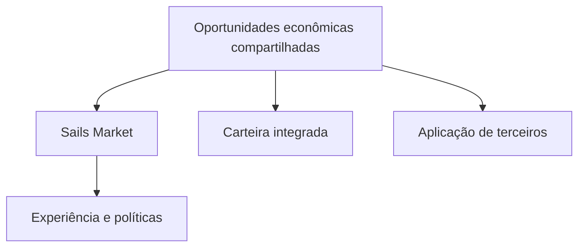

# Por que um mercado de referência não deve isolar sua liquidez

*Rascunho editorial. Publicação não aprovada.*

## O problema

Imagine uma carteira e um mercado web mostrando oportunidades diferentes apesar de participarem do mesmo ecossistema. Se cada interface cria sua própria liquidez isolada, os participantes enfrentam fragmentação em vez de um mercado compartilhado.

## O limite

Nossa direção para o Sails Market é uma aplicação web de referência que consome as mesmas oportunidades econômicas disponíveis a carteiras integradas e terceiros. O mercado pode apresentar ofertas, organizar salas privadas e conectar serviços externos sem fingir que todos esses serviços são módulos nativos do Sails Protocol.

## O que ainda precisa ser comprovado

Visibilidade compartilhada não garante execução nem profundidade de mercado. A liquidez depende de contrapartes, roteamento, disponibilidade, preços e permissões. Uma aplicação de referência deve mostrar essas limitações com clareza, inclusive quando uma oportunidade não está disponível para determinado usuário ou meio de pagamento.

## Diagrama conceitual

Equivalente textual: o diagrama mostra os limites de responsabilidade descritos acima, não uma implantação verificada.

*Referências, revisão técnica e aprovação do responsável pela publicação pendentes.*
