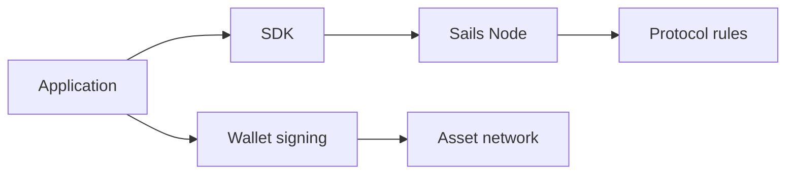

# Wallets, Nodes and Application Boundaries

*Editorial draft. Not approved for publication.*

## The problem

When a user clicks Confirm, several systems may be involved. The interface receives intent, a wallet authorizes signing, a node coordinates a workflow and an external network may carry value. Confusing these responsibilities creates security and product risks.

## The boundary

A coordination node should not be described as a custodian merely because it tracks trade state. Likewise, a noncustodial wallet does not eliminate the need to validate trade authorization and external payment evidence. Each boundary needs its own threat model.

## What remains to be proven

Sails Core, Sails Node, SDKs and applications have different responsibilities. We use that separation to ask where economic authority lives and where a failure can propagate. A diagram of the intended separation is useful, but implementation evidence must confirm that permissions and secrets actually remain within their expected boundaries.

## Conceptual diagram

Text equivalent: the diagram shows the responsibility boundaries discussed above, not verified deployment.

*Source references, technical review and owner publication approval pending.*

## Failure scenario: the coordinator knows the trade, but not the user's consent

A buyer starts a trade in an application. The coordination node stores its identifier and state. Later, the application asks the wallet to sign a transfer, but the displayed destination belongs to another trade. Even if the node's record is internally consistent and the wallet produces a valid cryptographic signature, the two facts do not establish that the buyer approved **this** destination for **this** trade. The wallet must verify the amount, asset, network, destination and trade context before presenting an approval. The node must independently enforce participant authority and valid state transitions; an external settlement observation must be checked at its own boundary.

The opposite failure is also possible: a provider reports a payment or a transaction appears on a network, but the coordinator has not yet established the correct trade association or the necessary finality. Advancing the trade merely because an external message arrived would conflate a report with authoritative settlement. Recovery must preserve uncertainty instead of manufacturing success.

## Architectural trade-off and verification

A single application could hold signing keys, coordination state and settlement adapters in one service. That reduces integration boundaries but concentrates authority and makes it harder to audit who approved a transfer. Separating wallet signing, coordination and external settlement adds cross-component reconciliation, retries and explicit identity binding. The separation is worthwhile only if the implementation enforces it rather than merely drawing separate boxes.

**Next test:** submit a correctly signed transfer request with a mismatched trade destination, then repeat after a lost coordination response and a delayed provider observation. Record whether each boundary rejects or holds the uncertain operation without a second economic effect. Verify the exact code revision and provider-specific evidence. The pinned protocol invariants document establishes intended boundaries, **not** that this test has passed or that any wallet/node combination is live.

## Evidence boundary and failure mode

Responsibility boundaries do not prove a production deployment or independent node interoperability. **Failure:** interpreting this architectural or source-inspected statement as current production verification. Exact-head tests and approval are still required.

- [PROTOCOL_INVARIANTS.md](https://github.com/sails-protocol/Sails-Protocol/blob/be6d3bc2ddfc384cfafa4276e01b8aacc096d421/docs/PROTOCOL_INVARIANTS.md)
