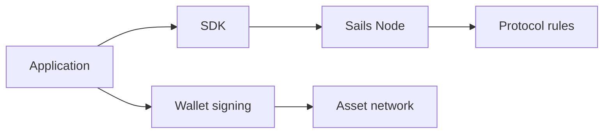

# Wallets, Nodes and Application Boundaries

*Editorial draft. Not approved for publication.*

## The problem

When a user clicks Confirm, several systems may be involved. The interface receives intent, a wallet authorizes signing, a node coordinates a workflow and an external network may carry value. Confusing these responsibilities creates security and product risks.

## The boundary

A coordination node should not be described as a custodian merely because it tracks trade state. Likewise, a noncustodial wallet does not eliminate the need to validate trade authorization and external payment evidence. Each boundary needs its own threat model.

## What remains to be proven

Sails Core, Sails Node, SDKs and applications have different responsibilities. We use that separation to ask where economic authority lives and where a failure can propagate. A diagram of the intended separation is useful, but implementation evidence must confirm that permissions and secrets actually remain within their expected boundaries.

## Conceptual diagram

Text equivalent: the diagram shows the responsibility boundaries discussed above, not verified deployment.

*Source references, technical review and owner publication approval pending.*
