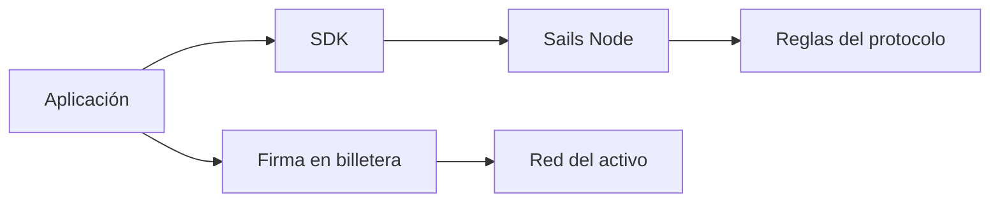

# Billeteras, nodos y límites de las aplicaciones

*Borrador editorial. Publicación no aprobada.*

## El problema

Cuando alguien pulsa Confirmar pueden intervenir varios sistemas. La interfaz recibe la intención, la billetera autoriza firmas, un nodo coordina el flujo y una red externa puede mover valor. Confundir esas responsabilidades crea riesgos de seguridad y de producto.

## El límite

Un nodo de coordinación no debería describirse como custodio solo porque registra el estado de una operación. Del mismo modo, una billetera no custodial no elimina la necesidad de validar autorizaciones y evidencias de pagos externos. Cada límite necesita su propio modelo de amenazas.

## Qué falta demostrar

Sails Core, Sails Node, SDKs y aplicaciones tienen responsabilidades distintas. Usamos esa separación para preguntar dónde reside la autoridad económica y por dónde puede propagarse un fallo. Un diagrama ayuda, pero las evidencias de implementación deben confirmar que los permisos y secretos permanecen en sus límites previstos.

## Diagrama conceptual

Equivalente textual: el diagrama muestra los límites de responsabilidad descritos arriba, no un despliegue verificado.

*Referencias, revisión técnica y aprobación del responsable de publicación pendientes.*
