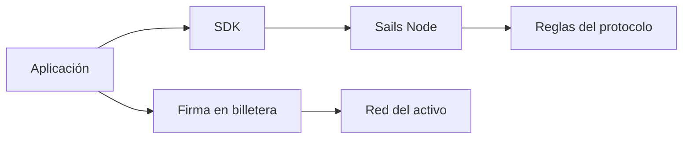

# Billeteras, nodos y límites de las aplicaciones

*Borrador editorial. Publicación no aprobada.*

## El problema

Cuando alguien pulsa Confirmar pueden intervenir varios sistemas. La interfaz recibe la intención, la billetera autoriza firmas, un nodo coordina el flujo y una red externa puede mover valor. Confundir esas responsabilidades crea riesgos de seguridad y de producto.

## El límite

Un nodo de coordinación no debería describirse como custodio solo porque registra el estado de una operación. Del mismo modo, una billetera no custodial no elimina la necesidad de validar autorizaciones y evidencias de pagos externos. Cada límite necesita su propio modelo de amenazas.

## Qué falta demostrar

Sails Core, Sails Node, SDKs y aplicaciones tienen responsabilidades distintas. Usamos esa separación para preguntar dónde reside la autoridad económica y por dónde puede propagarse un fallo. Un diagrama ayuda, pero las evidencias de implementación deben confirmar que los permisos y secretos permanecen en sus límites previstos.

## Diagrama conceptual

Equivalente textual: el diagrama muestra los límites de responsabilidad descritos arriba, no un despliegue verificado.

*Referencias, revisión técnica y aprobación del responsable de publicación pendientes.*

## Escenario de fallo: el coordinador conoce la operación, pero no el consentimiento

Un comprador inicia una operación en la aplicación. El nodo de coordinación guarda su identificador y estado. Más tarde, la aplicación solicita una firma a la billetera, pero el destino mostrado corresponde a otra operación. Aunque el registro del nodo sea coherente y la billetera produzca una firma criptográficamente válida, esos hechos no demuestran que el comprador haya aprobado **ese** destino para **esa** operación. Antes de confirmar, la billetera debe comprobar importe, activo, red, destino y contexto. El nodo debe validar por separado la autoridad del participante y las transiciones de estado; la observación de liquidación externa pertenece a otro límite de confianza.

También existe el fallo inverso: un proveedor informa un pago o aparece una transacción en la red, pero el coordinador todavía no ha demostrado su asociación con la operación correcta ni la finalidad requerida. Avanzar el estado solo porque llegó un mensaje externo confundiría un informe con liquidación autoritativa. La recuperación debe conservar la incertidumbre, no inventar éxito.

## Alternativa arquitectónica y verificación

Un solo servicio podría controlar claves de firma, estado de coordinación y adaptadores de liquidación. Esto reduce límites de integración, pero concentra autoridad y dificulta auditar quién aprobó una transferencia. Separar la firma de la billetera, la coordinación y la liquidación externa exige reconciliación, reintentos y vinculación explícita de identidad. La separación solo tiene valor si la implementación aplica los límites y no se limita a dibujarlos.

**Siguiente prueba:** presentar una solicitud de transferencia con firma válida, pero destino distinto del asociado a la operación; repetir tras perderse la respuesta de coordinación y retrasarse la observación del proveedor. Registrar si cada límite rechaza o mantiene la operación incierta sin un segundo efecto económico. Verificar el commit exacto y la evidencia específica del proveedor. Los invariantes del protocolo citados abajo documentan límites previstos, **no** la aprobación de esta prueba ni una combinación billetera/nodo desplegada.

## Límite de evidencia y fallo

La separación de responsabilidades no demuestra despliegue productivo ni interoperabilidad de nodos independientes. **Fallo:** interpretar arquitectura o código inspeccionado como prueba de producción. Faltan pruebas del HEAD exacto y aprobación.

- [PROTOCOL_INVARIANTS.md](https://github.com/sails-protocol/Sails-Protocol/blob/be6d3bc2ddfc384cfafa4276e01b8aacc096d421/docs/PROTOCOL_INVARIANTS.md)
