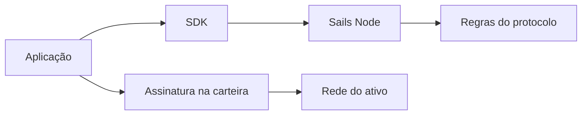

# Carteiras, nós e os limites das aplicações

*Rascunho editorial. Publicação não aprovada.*

## O problema

Quando alguém toca em Confirmar, vários sistemas podem participar. A interface recebe a intenção, a carteira autoriza assinaturas, um nó coordena o fluxo e uma rede externa pode movimentar valor. Confundir essas responsabilidades cria riscos de segurança e de produto.

## O limite

Um nó de coordenação não deve ser descrito como custodiante apenas porque acompanha o estado de uma negociação. Da mesma forma, uma carteira não custodial não elimina a necessidade de validar autorizações e evidências de pagamentos externos. Cada limite precisa de seu próprio modelo de ameaças.

## O que ainda precisa ser comprovado

Sails Core, Sails Node, SDKs e aplicações têm responsabilidades diferentes. Usamos essa separação para perguntar onde vive a autoridade econômica e por onde uma falha pode se propagar. Um diagrama ajuda, mas as evidências de implementação precisam confirmar que permissões e segredos permanecem nos limites previstos.

## Diagrama conceitual

Equivalente textual: o diagrama mostra os limites de responsabilidade descritos acima, não uma implantação verificada.

*Referências, revisão técnica e aprovação do responsável pela publicação pendentes.*

## Cenário de falha: o coordenador conhece a negociação, mas não o consentimento

Um comprador inicia uma negociação no aplicativo. O nó de coordenação registra o identificador e o estado. Depois, o aplicativo solicita à carteira uma assinatura, mas o destino exibido pertence a outra negociação. Mesmo que o registro do nó esteja internamente consistente e a carteira produza uma assinatura criptograficamente válida, isso não demonstra que o comprador aprovou **aquele** destino para **aquela** negociação. Antes da confirmação, a carteira precisa conferir valor, ativo, rede, destino e contexto. O nó deve validar separadamente a autoridade do participante e as transições de estado; a observação de liquidação externa pertence a outro limite de confiança.

A falha inversa também importa: um provedor informa um pagamento ou surge uma transação na rede, mas o coordenador ainda não comprovou sua associação à negociação correta ou a finalidade exigida. Avançar o estado apenas porque chegou uma mensagem externa confundiria relato com liquidação autoritativa. A recuperação precisa preservar a incerteza, não inventar sucesso.

## Alternativa arquitetural e verificação

Um único serviço poderia controlar chaves de assinatura, estado de coordenação e adaptadores de liquidação. Isso reduz pontos de integração, mas concentra autoridade e dificulta auditar quem aprovou uma transferência. Separar assinatura da carteira, coordenação e liquidação externa exige reconciliação, tentativas repetidas e vínculo explícito de identidade. A separação só tem valor se o código realmente impuser os limites desenhados.

**Próximo teste:** enviar uma solicitação de transferência com assinatura válida, porém destino divergente da negociação; repetir após perda da resposta de coordenação e atraso na observação do provedor. Registrar se cada limite rejeita ou mantém a operação incerta sem um segundo efeito econômico. Conferir o commit exato e as evidências específicas do provedor. As invariantes do protocolo citadas abaixo documentam limites pretendidos, **não** a aprovação desse teste nem a existência de uma combinação carteira/nó em produção.

## Fronteira de evidência e falha

Divisão de responsabilidades não comprova implantação em produção nem interoperabilidade de nós independentes. **Falha:** interpretar arquitetura ou código examinado como comprovação de produção. Ainda faltam testes no HEAD exato e aprovação.

- [PROTOCOL_INVARIANTS.md](https://github.com/sails-protocol/Sails-Protocol/blob/be6d3bc2ddfc384cfafa4276e01b8aacc096d421/docs/PROTOCOL_INVARIANTS.md)
