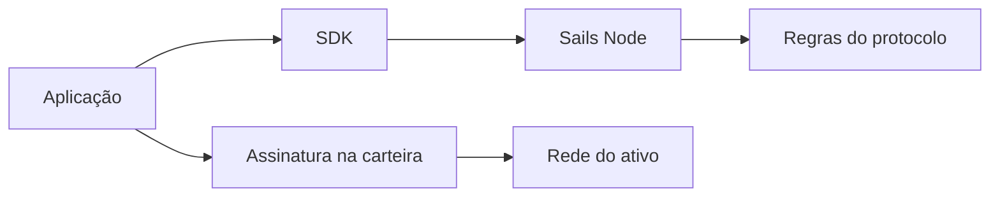

# Carteiras, nós e os limites das aplicações

*Rascunho editorial. Publicação não aprovada.*

## O problema

Quando alguém toca em Confirmar, vários sistemas podem participar. A interface recebe a intenção, a carteira autoriza assinaturas, um nó coordena o fluxo e uma rede externa pode movimentar valor. Confundir essas responsabilidades cria riscos de segurança e de produto.

## O limite

Um nó de coordenação não deve ser descrito como custodiante apenas porque acompanha o estado de uma negociação. Da mesma forma, uma carteira não custodial não elimina a necessidade de validar autorizações e evidências de pagamentos externos. Cada limite precisa de seu próprio modelo de ameaças.

## O que ainda precisa ser comprovado

Sails Core, Sails Node, SDKs e aplicações têm responsabilidades diferentes. Usamos essa separação para perguntar onde vive a autoridade econômica e por onde uma falha pode se propagar. Um diagrama ajuda, mas as evidências de implementação precisam confirmar que permissões e segredos permanecem nos limites previstos.

## Diagrama conceitual

Equivalente textual: o diagrama mostra os limites de responsabilidade descritos acima, não uma implantação verificada.

*Referências, revisão técnica e aprovação do responsável pela publicação pendentes.*

## Fronteira de evidência e falha

Divisão de responsabilidades não comprova implantação em produção nem interoperabilidade de nós independentes. **Falha:** interpretar arquitetura ou código examinado como comprovação de produção. Ainda faltam testes no HEAD exato e aprovação.

- [PROTOCOL_INVARIANTS.md](https://github.com/sails-protocol/Sails-Protocol/blob/be6d3bc2ddfc384cfafa4276e01b8aacc096d421/docs/PROTOCOL_INVARIANTS.md)
