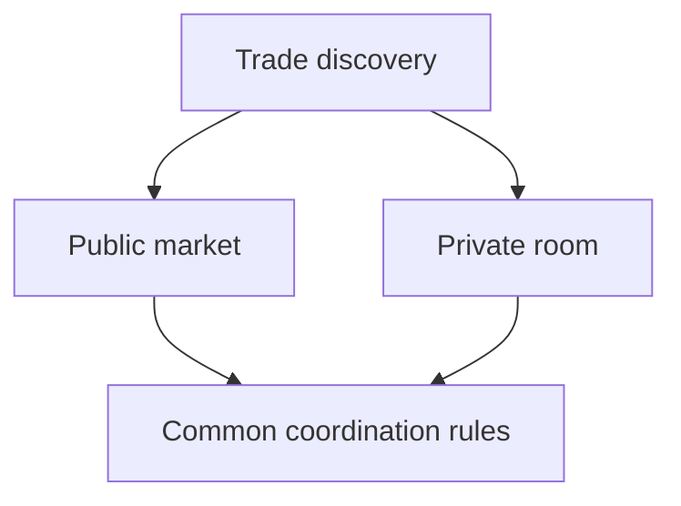

# Private Trading Rooms and Open Markets

*Editorial draft. Not approved for publication.*

## The problem

Not every P2P trade belongs in a public order book. A community may want to trade within a trusted group; a business may want restricted counterparties; another participant may prefer public discovery.

## The boundary

Private rooms are part of the Sails Market product direction. But private discovery, access control and economic settlement are separate concerns. Hiding an offer from public search does not automatically encrypt every message, protect metadata or guarantee that a counterparty is trustworthy.

## What remains to be proven

A good design must explain who can create a room, invite members, revoke access, see historical activity and initiate trades. It must also explain which coordination rules are common to public and private contexts. These are product and security questions to validate, not completed features to announce.

## Conceptual diagram

Text equivalent: the diagram shows the responsibility boundaries discussed above, not verified deployment.

*Source references, technical review and owner publication approval pending.*

## Failure scenario: membership changes while a trade is in flight

A room administrator removes a participant after that participant has viewed an offer but before accepting it. The cached offer may remain visible in the client. If the server checks only whether the offer was once discovered, the removed participant might still initiate a trade. If the system instead invalidates every active trade on membership change, legitimate trades may become impossible to finish or dispute. Visibility, authorization to initiate a new action, and authority over an already-created obligation need separate rules.

A second risk is assuming that private discovery provides confidential transport. Even when the offer list is hidden, notification timing, counterparties and settlement metadata can still be exposed through other systems. The interface should not promise anonymity or encrypted messaging without verified evidence.

## Decision, trade-off and next test

The product must define membership snapshots, revocation semantics, the fate of in-flight trades and independent settlement permissions. Strict revocation reduces unwanted new activity but requires recovery rules for existing obligations. Permissive completion preserves continuity but must not silently grant new authority.

**Next test:** race a room membership revocation against offer acceptance and replay a previously authorized request after revocation. Verify that new unauthorized transitions are rejected, while existing obligations follow explicit dispute and settlement rules. Test metadata visibility separately. The pinned threat model describes risks; it does **not** certify deployed private rooms or privacy guarantees.

## Inspected boundary and failure

Private visibility is not immunity from collusion or unauthorized transitions. **Failure:** overstating design as verified deployment. The pinned source supports only the stated scope; runtime and CTO gates remain open.

- [THREAT_MODEL.md](https://github.com/sails-protocol/Sails-Protocol/blob/be6d3bc2ddfc384cfafa4276e01b8aacc096d421/docs/THREAT_MODEL.md)
