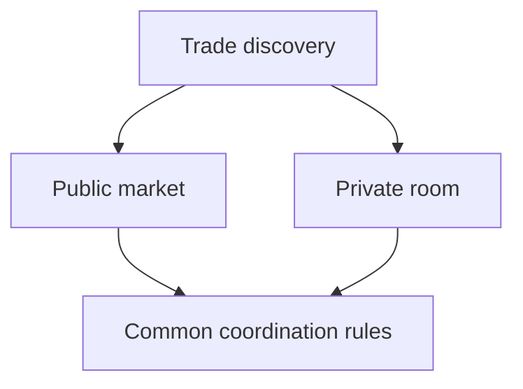

# Private Trading Rooms and Open Markets

*Editorial draft. Not approved for publication.*

## The problem

Not every P2P trade belongs in a public order book. A community may want to trade within a trusted group; a business may want restricted counterparties; another participant may prefer public discovery.

## The boundary

Private rooms are part of the Sails Market product direction. But private discovery, access control and economic settlement are separate concerns. Hiding an offer from public search does not automatically encrypt every message, protect metadata or guarantee that a counterparty is trustworthy.

## What remains to be proven

A good design must explain who can create a room, invite members, revoke access, see historical activity and initiate trades. It must also explain which coordination rules are common to public and private contexts. These are product and security questions to validate, not completed features to announce.

## Conceptual diagram

Text equivalent: the diagram shows the responsibility boundaries discussed above, not verified deployment.

*Source references, technical review and owner publication approval pending.*

## Inspected boundary and failure

Private visibility is not immunity from collusion or unauthorized transitions. **Failure:** overstating design as verified deployment. The pinned source supports only the stated scope; runtime and CTO gates remain open.

- [THREAT_MODEL.md](https://github.com/sails-protocol/Sails-Protocol/blob/be6d3bc2ddfc384cfafa4276e01b8aacc096d421/docs/THREAT_MODEL.md)
