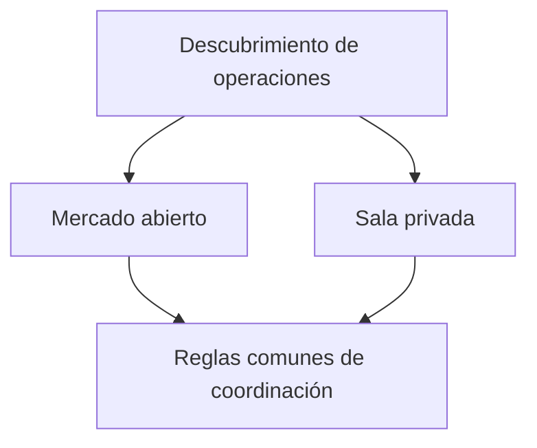

# Salas privadas de negociación y mercados abiertos

*Borrador editorial. Publicación no aprobada.*

## El problema

No todas las operaciones P2P necesitan estar en un libro público de ofertas. Una comunidad puede querer negociar dentro de un grupo; una empresa puede restringir contrapartes; otra persona puede preferir el descubrimiento público.

## El límite

Las salas privadas forman parte de la dirección de producto de Sails Market. Pero el descubrimiento privado, el control de acceso y la liquidación económica son cuestiones distintas. Ocultar una oferta de la búsqueda pública no cifra automáticamente todos los mensajes, no protege todos los metadatos ni garantiza que la contraparte sea confiable.

## Qué falta demostrar

Un buen diseño debe explicar quién puede crear una sala, invitar participantes, revocar acceso, consultar el historial e iniciar operaciones. También debe explicar qué reglas de coordinación comparten los contextos públicos y privados. Son preguntas de producto y seguridad por validar, no funciones terminadas para anunciar.

## Diagrama conceptual

Equivalente textual: el diagrama muestra los límites de responsabilidad descritos arriba, no un despliegue verificado.

*Referencias, revisión técnica y aprobación del responsable de publicación pendientes.*

## Límite examinado y fallo

La visibilidad privada no impide colusión ni transiciones no autorizadas. **Fallo:** presentar diseño como despliegue verificado. La fuente fijada solo respalda este alcance; siguen pendientes los gates de ejecución y CTO.

- [THREAT_MODEL.md](https://github.com/sails-protocol/Sails-Protocol/blob/be6d3bc2ddfc384cfafa4276e01b8aacc096d421/docs/THREAT_MODEL.md)
