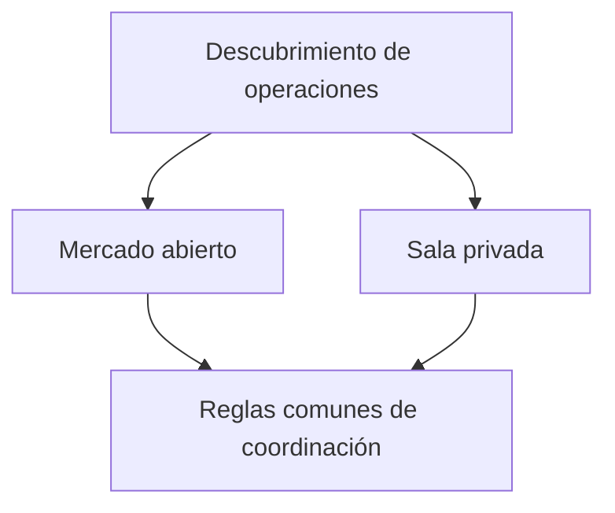

# Salas privadas de negociación y mercados abiertos

*Borrador editorial. Publicación no aprobada.*

## El problema

No todas las operaciones P2P necesitan estar en un libro público de ofertas. Una comunidad puede querer negociar dentro de un grupo; una empresa puede restringir contrapartes; otra persona puede preferir el descubrimiento público.

## El límite

Las salas privadas forman parte de la dirección de producto de Sails Market. Pero el descubrimiento privado, el control de acceso y la liquidación económica son cuestiones distintas. Ocultar una oferta de la búsqueda pública no cifra automáticamente todos los mensajes, no protege todos los metadatos ni garantiza que la contraparte sea confiable.

## Qué falta demostrar

Un buen diseño debe explicar quién puede crear una sala, invitar participantes, revocar acceso, consultar el historial e iniciar operaciones. También debe explicar qué reglas de coordinación comparten los contextos públicos y privados. Son preguntas de producto y seguridad por validar, no funciones terminadas para anunciar.

## Diagrama conceptual

Equivalente textual: el diagrama muestra los límites de responsabilidad descritos arriba, no un despliegue verificado.

*Referencias, revisión técnica y aprobación del responsable de publicación pendientes.*

## Escenario de fallo: cambia la membresía durante una operación

Un administrador elimina a alguien de una sala después de que esa persona haya visto una oferta, pero antes de aceptarla. La oferta puede seguir en la caché de la aplicación. Si el servidor solo comprueba que la oferta se descubrió antes, la persona expulsada podría iniciar una operación. En cambio, cancelar automáticamente todas las operaciones en curso al revocar la membresía podría impedir que se completen o disputen obligaciones legítimas. La visibilidad, la autorización para iniciar una acción nueva y la autoridad sobre una obligación ya creada necesitan reglas distintas.

Tampoco debe suponerse que el descubrimiento privado implica transporte confidencial. Aunque la lista de ofertas esté oculta, los horarios de notificaciones, las contrapartes y los metadatos de liquidación pueden quedar expuestos en otros sistemas. La interfaz no debe prometer anonimato ni mensajes cifrados sin evidencia verificada.

## Decisión, alternativa y siguiente prueba

El producto debe definir el estado de membresía aplicable a cada acción, la semántica de revocación, el destino de operaciones en curso y los permisos independientes de liquidación. Una revocación estricta reduce acciones nuevas indebidas, pero exige reglas de recuperación para obligaciones existentes. Permitir su conclusión preserva continuidad, pero no debe otorgar nueva autoridad de forma silenciosa.

**Siguiente prueba:** hacer competir una revocación de membresía con la aceptación de una oferta y repetir una solicitud anteriormente autorizada tras la revocación. Verificar el rechazo de nuevas transiciones no autorizadas y el tratamiento explícito de obligaciones existentes. Probar por separado la exposición de metadatos. El modelo de amenazas citado describe riesgos, **no** certifica salas privadas desplegadas ni garantías de privacidad.

## Límite examinado y fallo

La visibilidad privada no impide colusión ni transiciones no autorizadas. **Fallo:** presentar diseño como despliegue verificado. La fuente fijada solo respalda este alcance; siguen pendientes los gates de ejecución y CTO.

- [THREAT_MODEL.md](https://github.com/sails-protocol/Sails-Protocol/blob/be6d3bc2ddfc384cfafa4276e01b8aacc096d421/docs/THREAT_MODEL.md)
