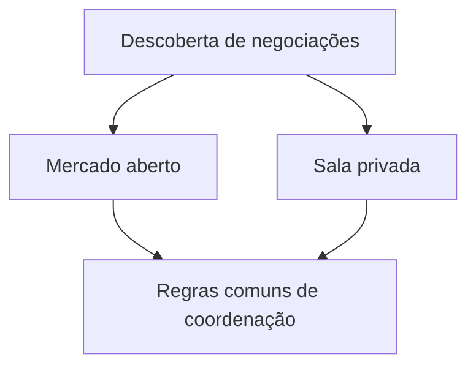

# Salas privadas de negociação e mercados abertos

*Rascunho editorial. Publicação não aprovada.*

## O problema

Nem toda negociação P2P precisa estar num livro público de ofertas. Uma comunidade pode querer negociar dentro de um grupo; uma empresa pode restringir contrapartes; outro participante pode preferir descoberta pública.

## O limite

Salas privadas fazem parte da direção de produto do Sails Market. Mas descoberta privada, controle de acesso e liquidação econômica são preocupações diferentes. Esconder uma oferta da busca pública não criptografa automaticamente todas as mensagens, não protege todos os metadados nem garante que a contraparte seja confiável.

## O que ainda precisa ser comprovado

Um bom desenho precisa explicar quem pode criar uma sala, convidar participantes, revogar acesso, ver o histórico e iniciar negociações. Também precisa explicar quais regras de coordenação são comuns aos contextos público e privado. São perguntas de produto e segurança a validar, não funcionalidades concluídas para anunciar.

## Diagrama conceitual

Equivalente textual: o diagrama mostra os limites de responsabilidade descritos acima, não uma implantação verificada.

*Referências, revisão técnica e aprovação do responsável pela publicação pendentes.*

## Fronteira examinada e falha

Visibilidade privada não impede conluio nem transições sem autorização. **Falha:** apresentar design como implantação comprovada. A fonte fixada sustenta apenas esse escopo; gates de execução e CTO seguem abertos.

- [THREAT_MODEL.md](https://github.com/sails-protocol/Sails-Protocol/blob/be6d3bc2ddfc384cfafa4276e01b8aacc096d421/docs/THREAT_MODEL.md)
