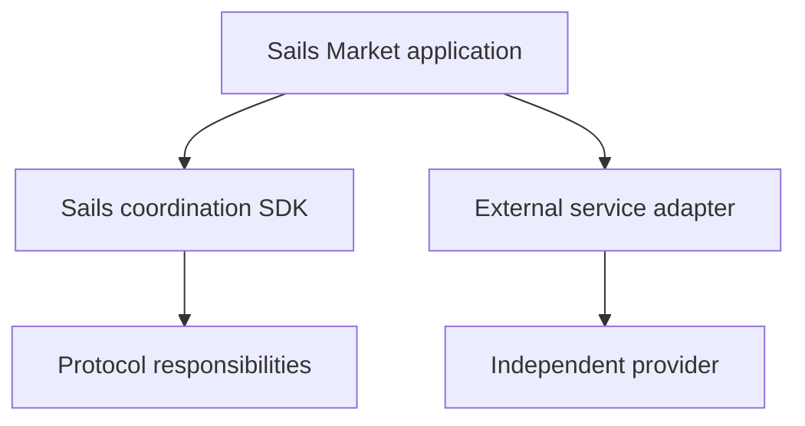

# Modular Integrations: Protocol or External Service?

*Editorial draft. Not approved for publication.*

## The problem

A trading application can include swaps, lending, prediction markets and payment ramps. That does not make every integrated service part of the underlying protocol. Clear boundaries matter for developers and for users deciding whom to trust.

## The boundary

Sails Market may integrate external services such as SideShift, Hyperliquid, Morpho or Polymarket, subject to feasibility, availability and policy. The Sails Protocol family addresses coordination capabilities. External products retain their own contracts, risks, settlement rules and availability. Integration does not imply partnership, endorsement or launch commitment.

## What remains to be proven

For every integration, documentation should identify the provider, the wallet permissions requested, the asset path, the economic fees and the failure/recovery behavior. Rebates or business incentives should be disclosed where relevant, without confusing them with protocol fees.

## Conceptual diagram

Text equivalent: the diagram shows the responsibility boundaries discussed above, not verified deployment.

*Source references, technical review and owner publication approval pending.*

## Failure scenario: a provider response is mistaken for protocol finality

An application routes a proposed swap through an external adapter. The provider returns an accepted request identifier, but the actual settlement remains pending or later fails. If the Sails Market interface labels that acknowledgment as completed settlement, users may act on funds that have not arrived. The opposite failure occurs when an external service succeeds but its callback is delayed and the application retries with a different identifier, potentially creating another obligation.

The trust boundary must identify who controls funds, who can reverse or dispute an operation, which network or provider determines finality, and what information the application merely displays. An adapter registry is evidence that a software integration point exists, not that a named external product is connected, endorsed, available in every jurisdiction or safe in production.

## Trade-off and verification

Direct integrations can simplify the interface, but they also combine distinct terms, fees, recovery procedures and compliance obligations behind one screen. Explicit provider labeling and per-action confirmation introduce friction while preserving the user's ability to distinguish protocol coordination from third-party execution.

**Next test:** simulate an accepted-but-unsettled provider response, a delayed callback and a retry after timeout. Verify that the application preserves pending status, reconciles identifiers and does not attribute provider guarantees to Sails Protocol. Check provider-specific contracts and operational evidence before any launch claim. The pinned registry does **not** prove these scenarios passed.

## Inspected boundary and failure

The provider registry identifies adapters; external services do not become the Sails Protocol. **Failure:** overstating design as verified deployment. The pinned source supports only the stated scope; runtime and CTO gates remain open.

- [escrow-providers.ts](https://github.com/sails-protocol/Sails-Protocol/blob/be6d3bc2ddfc384cfafa4276e01b8aacc096d421/src/modules/open-settlement/escrow-providers.ts)
