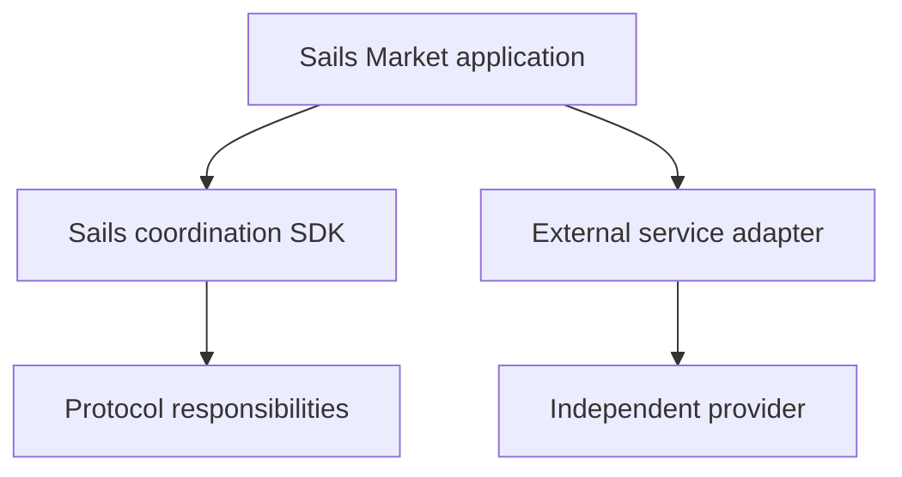

# Modular Integrations: Protocol or External Service?

*Editorial draft. Not approved for publication.*

## The problem

A trading application can include swaps, lending, prediction markets and payment ramps. That does not make every integrated service part of the underlying protocol. Clear boundaries matter for developers and for users deciding whom to trust.

## The boundary

Sails Market may integrate external services such as SideShift, Hyperliquid, Morpho or Polymarket, subject to feasibility, availability and policy. The Sails Protocol family addresses coordination capabilities. External products retain their own contracts, risks, settlement rules and availability. Integration does not imply partnership, endorsement or launch commitment.

## What remains to be proven

For every integration, documentation should identify the provider, the wallet permissions requested, the asset path, the economic fees and the failure/recovery behavior. Rebates or business incentives should be disclosed where relevant, without confusing them with protocol fees.

## Conceptual diagram

Text equivalent: the diagram shows the responsibility boundaries discussed above, not verified deployment.

*Source references, technical review and owner publication approval pending.*
