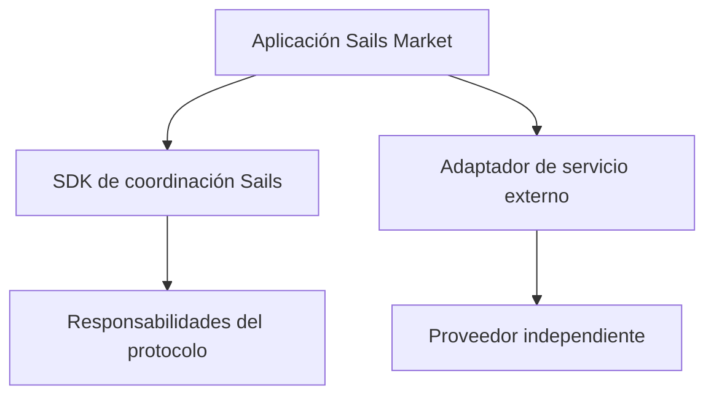

# Integraciones modulares: ¿protocolo o servicio externo?

*Borrador editorial. Publicación no aprobada.*

## El problema

Una aplicación de negociación puede incluir swaps, préstamos, mercados de predicción y rampas de pago. Eso no convierte cada servicio integrado en parte del protocolo subyacente. Los límites claros importan para desarrolladores y usuarios que deben decidir en quién confiar.

## El límite

Sails Market podría integrar servicios externos como SideShift, Hyperliquid, Morpho o Polymarket, según viabilidad, disponibilidad y políticas. La familia Sails Protocol aborda capacidades de coordinación. Los productos externos mantienen sus contratos, riesgos, reglas de liquidación y disponibilidad. Integrar no implica asociación, respaldo ni compromiso de lanzamiento.

## Qué falta demostrar

Para cada integración, la documentación debería identificar el proveedor, los permisos solicitados a la billetera, la ruta de los activos, las comisiones económicas y el comportamiento ante fallos. Los rebates o incentivos comerciales deben informarse cuando correspondan, sin confundirlos con tarifas del protocolo.

## Diagrama conceptual

Equivalente textual: el diagrama muestra los límites de responsabilidad descritos arriba, no un despliegue verificado.

*Referencias, revisión técnica y aprobación del responsable de publicación pendientes.*

## Escenario de fallo: la respuesta del proveedor se confunde con finalidad

Una aplicación envía un intercambio propuesto mediante un adaptador externo. El proveedor devuelve el identificador de una solicitud aceptada, pero la liquidación sigue pendiente o falla más tarde. Si Sails Market presenta ese acuse como liquidación completada, el usuario puede actuar sobre fondos que todavía no llegaron. También puede ocurrir lo contrario: el servicio externo completa la operación, pero su respuesta se retrasa y la aplicación reintenta con otro identificador, creando posiblemente una segunda obligación.

El límite de confianza debe identificar quién controla los activos, quién puede revertir o disputar una operación, qué red o proveedor determina la finalidad y qué información solo muestra la aplicación. Un registro de adaptadores demuestra un punto de integración en el software, no que un producto externo esté conectado, respalde Sails, esté disponible en todas las jurisdicciones o sea seguro en producción.

## Alternativa y verificación

Las integraciones directas simplifican la interfaz, pero también agrupan términos, comisiones, recuperación y obligaciones regulatorias diferentes detrás de una sola pantalla. Identificar al proveedor y solicitar confirmación por operación añade pasos, pero permite distinguir coordinación del protocolo y ejecución de terceros.

**Siguiente prueba:** simular una respuesta aceptada sin liquidación, una devolución de llamada retrasada y un reintento tras agotar el tiempo de espera. Verificar que la aplicación conserva el estado pendiente, reconcilia identificadores y no atribuye garantías del proveedor a Sails Protocol. Comprobar contratos y evidencia operativa específicos antes de anunciar el lanzamiento. El registro citado **no** prueba que estas pruebas hayan pasado.

## Límite examinado y fallo

El registro identifica adaptadores; los servicios externos no pasan a ser Sails Protocol. **Fallo:** presentar diseño como despliegue verificado. La fuente fijada solo respalda este alcance; siguen pendientes los gates de ejecución y CTO.

- [escrow-providers.ts](https://github.com/sails-protocol/Sails-Protocol/blob/be6d3bc2ddfc384cfafa4276e01b8aacc096d421/src/modules/open-settlement/escrow-providers.ts)
