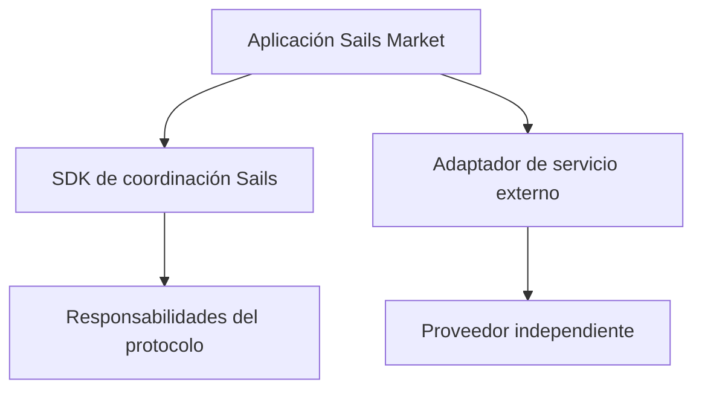

# Integraciones modulares: ¿protocolo o servicio externo?

*Borrador editorial. Publicación no aprobada.*

## El problema

Una aplicación de negociación puede incluir swaps, préstamos, mercados de predicción y rampas de pago. Eso no convierte cada servicio integrado en parte del protocolo subyacente. Los límites claros importan para desarrolladores y usuarios que deben decidir en quién confiar.

## El límite

Sails Market podría integrar servicios externos como SideShift, Hyperliquid, Morpho o Polymarket, según viabilidad, disponibilidad y políticas. La familia Sails Protocol aborda capacidades de coordinación. Los productos externos mantienen sus contratos, riesgos, reglas de liquidación y disponibilidad. Integrar no implica asociación, respaldo ni compromiso de lanzamiento.

## Qué falta demostrar

Para cada integración, la documentación debería identificar el proveedor, los permisos solicitados a la billetera, la ruta de los activos, las comisiones económicas y el comportamiento ante fallos. Los rebates o incentivos comerciales deben informarse cuando correspondan, sin confundirlos con tarifas del protocolo.

## Diagrama conceptual

Equivalente textual: el diagrama muestra los límites de responsabilidad descritos arriba, no un despliegue verificado.

*Referencias, revisión técnica y aprobación del responsable de publicación pendientes.*
