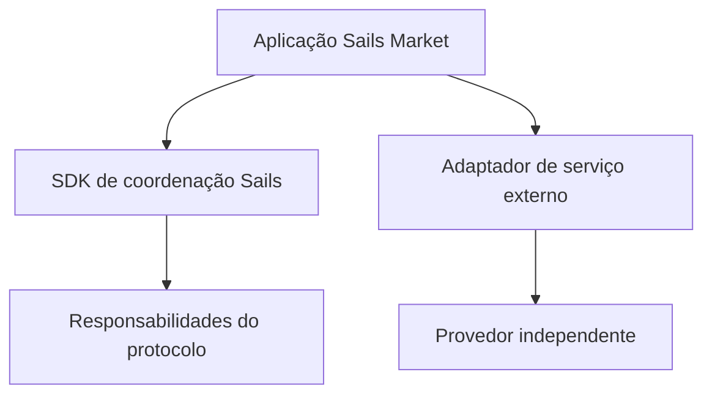

# Integrações modulares: protocolo ou serviço externo?

*Rascunho editorial. Publicação não aprovada.*

## O problema

Uma aplicação de negociação pode incluir swaps, empréstimos, mercados de previsão e rampas de pagamento. Isso não transforma cada serviço integrado em parte do protocolo subjacente. Limites claros importam para desenvolvedores e usuários que precisam decidir em quem confiar.

## O limite

Sails Market poderá integrar serviços externos como SideShift, Hyperliquid, Morpho ou Polymarket, conforme viabilidade, disponibilidade e política. A família Sails Protocol trata de capacidades de coordenação. Produtos externos mantêm seus próprios contratos, riscos, regras de liquidação e disponibilidade. Integração não implica parceria, endosso ou compromisso de lançamento.

## O que ainda precisa ser comprovado

Para cada integração, a documentação deve identificar o provedor, as permissões solicitadas à carteira, o caminho dos ativos, as taxas econômicas e o comportamento diante de falhas. Rebates ou incentivos comerciais devem ser informados quando relevantes, sem confundi-los com taxas do protocolo.

## Diagrama conceitual

Equivalente textual: o diagrama mostra os limites de responsabilidade descritos acima, não uma implantação verificada.

*Referências, revisão técnica e aprovação do responsável pela publicação pendentes.*

## Fronteira examinada e falha

O registro identifica adaptadores; serviços externos não se tornam o Sails Protocol. **Falha:** apresentar design como implantação comprovada. A fonte fixada sustenta apenas esse escopo; gates de execução e CTO seguem abertos.

- [escrow-providers.ts](https://github.com/sails-protocol/Sails-Protocol/blob/be6d3bc2ddfc384cfafa4276e01b8aacc096d421/src/modules/open-settlement/escrow-providers.ts)
