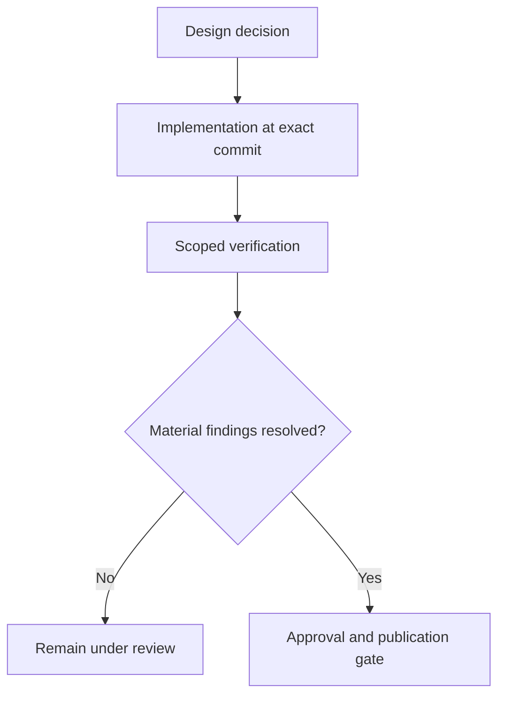

# From Design Decisions to Production Evidence

*Editorial draft. Not approved for publication.*

## The problem

A design review can establish what a system intends to guarantee. A unit test can show one behavior in a controlled environment. A database-backed integration test can demonstrate more. Production readiness requires still another level of evidence. These are not interchangeable.

## The boundary

We use explicit review gates in Sails engineering: define the invariant, build the implementation, test concurrency and restart where relevant, inspect the exact code revision and record unresolved findings. A passing CI badge alone does not prove that an economic workflow is safe.

## What remains to be proven

The blog should publish source references at the level of immutable commits, relevant tests, decision records and verified operational observations. A roadmap issue documents intent; a merged change documents code; a scoped verification run supports a specific claim. None should be promoted into a broader guarantee without justification.

## Conceptual diagram

Text equivalent: the diagram shows the responsibility boundaries discussed above, not verified deployment.

*Source references, technical review and owner publication approval pending.*

## Failure scenario: green tests, unsafe recovery

Suppose a trade transition passes its unit tests and the CI pipeline is green. Two workers then process the same delayed payment event while one instance restarts. Both workers may have individually valid observations, but if the database authority check is not atomic, they can produce conflicting outcomes. A successful build cannot establish that the concurrency and restart boundary is safe.

The evidence chain should distinguish the architectural invariant, the exact implementation commit, the executable test and its environment, the observed result, and the still-open material findings. A PostgreSQL-backed race test can strengthen a scoped claim; it does not automatically prove that every production worker, provider callback and settlement rail behaves identically.

## Decision, trade-off and release test

A faster release process might accept unit CI and manually inspect edge cases. The stronger alternative requires exact-head integration tests, explicit authority and idempotency checks, failure injection, independent review and a production-specific verification plan. This costs time but reduces the risk of turning an untested economic assumption into a public promise.

**Next test:** concurrently replay a delayed settlement observation across two workers, restart one mid-transition, and inspect whether exactly one authorized state transition is recorded while uncertain outcomes remain pending. Record test code, database version, run identifier, exact commit and reviewer disposition. Even a passing scoped test must not be advertised as universal production safety.

## Source-backed boundary and next test

Protocol invariants distinguish architectural law, implementation obligation and executable evidence. A design decision does not prove deployment.

**Failure to avoid:** presenting this inspected boundary as a deployed end-to-end guarantee. **Next verification:** exact-head behavior, integration tests and operational evidence. Source inspection only; editorial and CTO approval pending.

- [PROTOCOL_INVARIANTS.md](https://github.com/sails-protocol/Sails-Protocol/blob/be6d3bc2ddfc384cfafa4276e01b8aacc096d421/docs/PROTOCOL_INVARIANTS.md)
