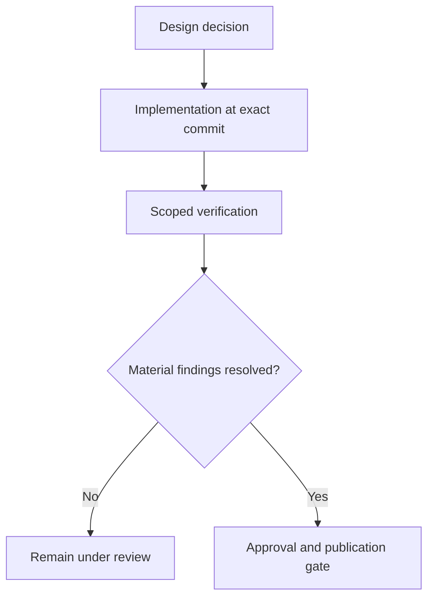

# From Design Decisions to Production Evidence

*Editorial draft. Not approved for publication.*

## The problem

A design review can establish what a system intends to guarantee. A unit test can show one behavior in a controlled environment. A database-backed integration test can demonstrate more. Production readiness requires still another level of evidence. These are not interchangeable.

## The boundary

We use explicit review gates in Sails engineering: define the invariant, build the implementation, test concurrency and restart where relevant, inspect the exact code revision and record unresolved findings. A passing CI badge alone does not prove that an economic workflow is safe.

## What remains to be proven

The blog should publish source references at the level of immutable commits, relevant tests, decision records and verified operational observations. A roadmap issue documents intent; a merged change documents code; a scoped verification run supports a specific claim. None should be promoted into a broader guarantee without justification.

## Conceptual diagram

Text equivalent: the diagram shows the responsibility boundaries discussed above, not verified deployment.

*Source references, technical review and owner publication approval pending.*
